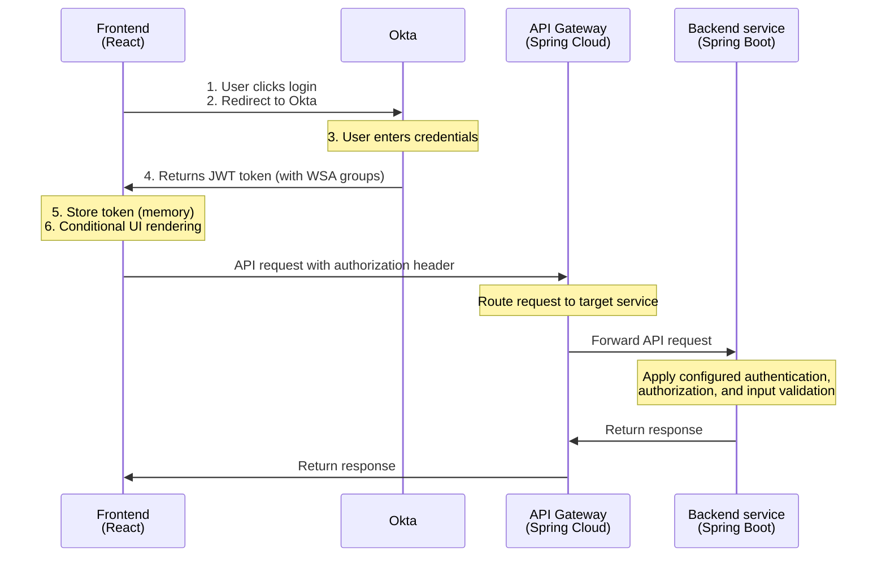

# Security Context

## Document Information

| Attribute | Value |
|-----------|-------|
| **Document Type** | Security Architecture & Context |
| **Last Updated** | 2025-12-18 |
| **Status** | Active |
| **Owner** | Architecture Team |

---

## 1. Executive Summary

This document provides an attack surface analysis for the Onshore platform. It identifies security controls and attack vectors relevant to the current implementation. Verify each control against active service configuration; this is not a security roadmap or mitigation plan.

**Key Security Principles:**
- **Defense in Depth**: Multiple layers of security controls
- **Zero Trust**: Verify all requests, assume breach mentality
- **Least Privilege**: Minimal permissions by default
- **Secure by Default**: Security built-in, not bolted-on

---

## 2. Architecture Security Overview

### 2.1 Security Layers

```
┌─────────────────────────────────────────────────────────────────┐
│                    EXTERNAL INFRASTRUCTURE                       │
│  (Handled by hosting environment - NOT in application scope)     │
│                                                                   │
│  • Network Firewalls / VPC                                       │
│  • DDoS Protection (Akamai)                                      │
│  • API Rate Limiting (Akamai)                                    │
│  • Load Balancers / API Gateway                                  │
│  • TLS Termination                                               │
│  • WAF (Web Application Firewall)                                │
└─────────────────────────────────────────────────────────────────┘
                              ↓
┌─────────────────────────────────────────────────────────────────┐
│                    APPLICATION PERIMETER                         │
│             (Onshore Responsibility - IN SCOPE)                   │
│                                                                   │
│  ┌──────────────────────────────────────────────────────────┐  │
│  │  Frontend (React / Vite)                                  │  │
│  │  Port: 5173 (development)                                 │  │
│  │                                                            │  │
│  │  Security Controls:                                        │  │
│  │  • OAuth 2.0 / OIDC Authentication                        │  │
│  │  • JWT Token Management                                    │  │
│  │  • Client-side Input Validation                           │  │
│  │  • XSS Protection (React escaping)                        │  │
│  │  • CSP Headers (via nginx)                                │  │
│  └──────────────────────────────────────────────────────────┘  │
│                              ↓                                    │
│  ┌──────────────────────────────────────────────────────────┐  │
│  │  API Gateway (Spring Cloud Gateway)                       │  │
│  │  Port: 5000                                               │  │
│  │  Routes requests to backend microservices                 │  │
│  └──────────────────────────────────────────────────────────┘  │
│                              ↓                                    │
│  ┌──────────────────────────────────────────────────────────┐  │
│  │  Backend Microservices (Spring Boot)                      │  │
│  │  Ports: 5001-5010; notification: 8094                     │  │
│  │  Verify authentication and authorization per service.     │  │
│  └──────────────────────────────────────────────────────────┘  │
│                              ↓                                    │
│  ┌──────────────────────────────────────────────────────────┐  │
│  │  Data Layer                                               │  │
│  │  • PostgreSQL (multiple databases)                        │  │
│  │                                                            │  │
│  │  Security Controls:                                        │  │
│  │  • Database Authentication                                 │  │
│  │  • Network Isolation (Docker network)                     │  │
│  │  • Connection Pooling with Credentials                    │  │
│  │  • Liquibase Change Management                            │  │
│  └──────────────────────────────────────────────────────────┘  │
└─────────────────────────────────────────────────────────────────┘
```

---

## 3. Authentication & Authorization Architecture

### 3.1 Authentication Flow



### 3.2 Identity Providers

Onshore's authentication provider and token-validation behavior must be confirmed against the active configuration:

| Provider | Environment | Status | Token Algorithm | Validation Method |
|----------|-------------|--------|-----------------|-------------------|
| **Okta** | Corporate/Production | ✅ Active | RS256 | JWKS validation with caching |

**Configuration:** Check the frontend and service configuration for the active authentication provider.

### 3.3 Token Management

**JWT Token Properties:**
- **Algorithm**: RS256 (RSA Signature with SHA-256)
- **Issuer**: Okta tenant
- **Audience**: Application-specific
- **Lifetime**: Configured in Okta (typically 1 hour)
- **Storage**: In-memory only (frontend), never localStorage/sessionStorage
- **Transmission**: Authorization: Bearer header only

**Security Controls:**
- ✅ Signature verification (Okta)
- ✅ Issuer validation
- ✅ Audience validation
- ✅ Expiration check (implicit in JWT library)
- ✅ Token in Authorization header only
- ✅ No token in URL parameters
- ✅ No token persistence in browser storage

### 3.4 Authorization Architecture

**WSA (Web Service Access) Groups:**
- JWT tokens contain WSA group claims from Okta
- Groups define user permissions and access levels
- Backend services must validate identity and enforce authorization independently of frontend UI checks.

**Frontend Authorization:**
- Conditional menu rendering based on WSA groups
- `WSAPermissionGuard` component for feature gating
- UI elements hidden/disabled based on permissions

**Backend Authorization:**
- Spring Security with JWT authentication
- Method-level `@PreAuthorize` annotations
- Role-based access control (RBAC) enforcement
- Service-layer permission checks

---

## 4. Attack Surface Analysis

### 4.1 External Attack Surface

#### 4.1.1 Frontend (React / Vite - Port 5173)

**Exposed Endpoints:**
- `/` - Main application UI
- `/oauth-callback` - OAuth redirect handler
- `/env.js` - Runtime configuration (production only)

**Attack Vectors:**

| Attack Type | Risk Level | Current Status | Controls |
|-------------|-----------|----------------|----------|
| **XSS (Cross-Site Scripting)** | Medium | ✅ Protected | React automatic escaping, CSP headers (nginx) |
| **CSRF (Cross-Site Request Forgery)** | Low | ✅ Protected | Token-based auth (no cookies), SameSite cookie attributes |
| **Clickjacking** | Low | ✅ Protected | X-Frame-Options header (nginx) |
| **Open Redirect** | Low | ⚠️ Partial | OAuth redirect validation (Okta handles) |
| **Token Theft** | Medium | ✅ Protected | Tokens in memory only, no localStorage |
| **Sensitive Data Exposure** | Medium | ⚠️ Review Needed | Avoid logging tokens, sanitize error messages |

**Not in Scope (Handled by Infrastructure):**
- ❌ DDoS attacks → Infrastructure rate limiting
- ❌ SSL/TLS attacks → Load balancer / API gateway handles
- ❌ Network layer attacks → VPC / firewall rules

#### 4.1.2 API Gateway (Spring Cloud Gateway - Port 5000)

**Exposed Surface:**
- Configured routes to backend microservices
- `/actuator/health` - Health endpoint, subject to gateway configuration

**Attack Vectors:**

| Attack Type | Risk Level | Current Status | Controls |
|-------------|-----------|----------------|----------|
| **Authentication / Authorization Bypass** | High | ⚠️ Verify | Confirm gateway and downstream service security configuration |
| **Route Exposure** | High | ⚠️ Verify | Review configured routes and restrict administrative endpoints |
| **CORS Misconfiguration** | Medium | ⚠️ Verify | Confirm allowed origins and methods for each environment |
| **Request Smuggling** | Low | ⚠️ Verify | Review proxy and gateway request handling configuration |
| **API Abuse / Rate Limiting** | Medium | ⚠️ Verify | Confirm gateway or infrastructure limits |
| **Denial of Service** | Medium | ⚠️ Infrastructure | Confirm infrastructure protections and gateway resource limits |

#### 4.1.3 Backend Microservices (Spring Boot - Ports 5001-5010, 8094)

**Exposed Endpoints:**
- Configured service API routes, exposed directly or through the API gateway
- `/actuator/health` - Health checks (should be restricted)
- `/actuator/**` - Spring Boot Actuator endpoints

**Attack Vectors:**

| Attack Type | Risk Level | Current Status | Controls |
|-------------|-----------|----------------|----------|
| **Unauthorized Direct Access** | High | ⚠️ Verify | Confirm service authentication and network access controls |
| **SQL Injection** | Medium | ✅ Protected | JPA/Hibernate parameterized queries |
| **Mass Assignment** | Low | ✅ Protected | DTO pattern, explicit field mapping |
| **Race Conditions** | Medium | ✅ Protected | JPA optimistic locking (@Version), last-write-wins |
| **Authentication Bypass** | High | ✅ Protected | Spring Security JWT validation |
| **Authorization Bypass** | High | ✅ Protected | Method-level @PreAuthorize, RBAC enforcement |
| **Privilege Escalation** | High | ✅ Protected | Role-based access control at service layer |
| **Actuator Exposure** | Medium | ⚠️ Partial | Health checks public, other endpoints accessible |
| **Deserialization Attacks** | Low | ✅ Protected | Jackson safe defaults, no custom deserializers |

**Concurrency Control Details:**

All JPA entities use optimistic locking via `@Version` annotation, providing protection against race conditions:

```java
@Version
private Long version;
```

**How it works:**
- Each entity has a version number that increments on every update
- When updating an entity, JPA checks if the version matches the database version
- If versions mismatch (another transaction updated the entity), `OptimisticLockException` is thrown
- Last-write-wins semantics: concurrent modifications require retry with latest data
- Prevents lost updates, dirty reads, and inconsistent state transitions

**Protected scenarios:**
- Concurrent status transitions (draft ↔ published)
- Duplicate creation attempts via unique constraints
- Concurrent slug/pageId modifications
- Business rule enforcement with version checking

#### 4.1.4 Databases (PostgreSQL - Ports 5432-5435)

**Exposed Ports (Development):**
- 5432 - Core database
- 5433 - Exposition database
- 5434 - Scheduler database

**Attack Vectors:**

| Attack Type | Risk Level | Current Status | Controls |
|-------------|-----------|----------------|----------|
| **Direct Database Access** | Critical | ⚠️ Dev Only | Ports exposed for development |
| **SQL Injection** | Low | ✅ Protected | JPA/Hibernate ORM prevents direct SQL |
| **Data Exfiltration** | High | ❌ No Monitoring | No audit trail for database queries |

**Notes:** 
- Production authentication is handled by Okta, which is managed by the Chanel team and is not part of this attack surface analysis.
- Database credentials in deployed environments are injected into containers via environment variables loaded from vault (managed by infrastructure), not stored in .env files. Credential theft and unauthorized access risks apply only to local development environments.

### 4.2 Internal Attack Surface

**Service-to-Service Communication:**

Currently, all services communicate over the Docker bridge network without authentication:

```
Frontend → API Gateway → Spring Boot microservices → Databases
```

**Internal Threats:**
- Container escape leading to lateral movement
- A compromised API gateway could access downstream services available to it
- Compromised backend could access all databases
- No service mesh or mTLS between services

---

## 5. Attack Surface NOT in Application Scope

These threats are **explicitly handled by infrastructure** and are **not the application's responsibility**:

### 5.1 Network Layer (OSI Layer 3-4)

| Attack Type | Infrastructure Control | Application Role |
|-------------|------------------------|------------------|
| **DDoS (Distributed Denial of Service)** | Akamai DDoS protection | None - infrastructure handles |
| **API Rate Limiting** | Akamai rate limiting & throttling | None - infrastructure handles |
| **SYN Flood** | Load balancer / firewall | None |
| **IP Spoofing** | Network firewall rules | None |
| **Port Scanning** | Security groups / firewall rules | None |
| **Network Sniffing** | VPC isolation, encrypted traffic | Ensure HTTPS/TLS in production |

### 5.2 TLS/SSL Termination

| Security Control | Infrastructure Role | Application Role |
|------------------|---------------------|------------------|
| **Certificate Management** | Load balancer / API gateway | None - trust infrastructure |
| **TLS Version Enforcement** | Load balancer configuration | None |
| **Cipher Suite Selection** | Infrastructure team | None |
| **Certificate Rotation** | Automated (Let's Encrypt, ACM) | None |
| **HSTS Headers** | Load balancer / reverse proxy | None (can also add in nginx) |

### 5.3 Rate Limiting & Throttling

| Control Level | Infrastructure | Application |
|---------------|----------------|-------------|
| **Global Rate Limiting** | Akamai API Gateway | None - handled by infrastructure |
| **Per-IP Rate Limiting** | Akamai rate limiting | None - handled by infrastructure |
| **Geographic Blocking** | Akamai CDN | None |
| **Bot Detection** | Akamai WAF | None |
| **DDoS Protection** | Akamai DDoS mitigation | None - handled by infrastructure |

**Note:** All rate limiting, throttling, and DDoS protection are handled by Akamai infrastructure and are **NOT** part of the application's attack surface or responsibility.

### 5.4 Infrastructure Security

| Security Domain | Infrastructure Responsibility |
|-----------------|------------------------------|
| **Container Image Scanning** | CI/CD pipeline (Trivy, Snyk, Clair) |
| **Vulnerability Patching** | Automated OS updates, managed services |
| **Secrets Management** | Vault, AWS Secrets Manager, Azure Key Vault |
| **Log Aggregation** | ELK, Splunk, CloudWatch, Application Insights |
| **Monitoring & Alerting** | Prometheus, Grafana, Datadog, New Relic |
| **Backup & Disaster Recovery** | Database backups, snapshot policies |
| **Compliance & Audit** | Cloud provider audit logs (CloudTrail, Activity Log) |

---

## 6. Security Testing Strategy

### 6.1 Testing Layers

| Test Type | Frequency | Tool/Method | Responsibility |
|-----------|-----------|-------------|----------------|
| **Static Analysis (SAST)** | Every commit | Veracode, SonarQube, ESLint, SpotBugs | CI/CD Pipeline |
| **Dependency Scanning** | Continuous | Veracode, Patrol, Maven dependency plugin, npm audit | CI/CD Pipeline |
| **Container Scanning** | Every build | Trivy, Patrol | CI/CD Pipeline |
| **Dynamic Analysis (DAST)** | Weekly | OWASP ZAP, Burp Suite | Security Team |
| **Penetration Testing** | Quarterly | External firm | Security Team |
| **E2E Security Tests** | Every release | Playwright E2E tests | Dev Team |

---

**End of Security Context Document**
