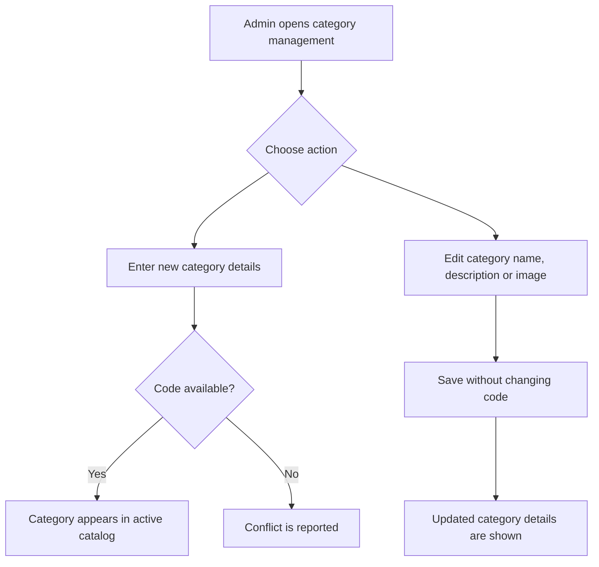

# User Story US001 - Manage Category Records

## 1. Description

Allows an admin to create a category with a unique code, name, optional description, and `image` containing the URL of the category image (a JPEG or PNG uploaded through the form and stored in a MinIO bucket), then edit its name, description, or image (replace only, not clear) through `PUT /api/categories/{code}` without changing its code. The category catalog is owned by `admin-service`. New categories are active and available in the catalog. Category activation, pricing, and assignment to activities are covered by separate stories.

## 2. User Story Statement

As an admin, I want to create and edit category records so that the platform uses consistent category definitions.

## 3. User Flow Diagram

## 4. UX / UI References

- No Figma or wireframe reference is included in EP001.
- Proposed category fields and endpoint behavior are documented in [specification-categories.md](../../specifications/specification-categories.md), sections 4 and 7.
- Assumption: the admin can distinguish code from editable name and description.

## 5. Dependencies

- Blocking: Authenticated admin role supplied through the API gateway.
- Blocking: Category catalog API in `admin-service`.
- Non-blocking: US002 - Browse Categories, for viewing the resulting catalog entry.

## 6. Personas & Primary Users

- Admin - maintains the shared category catalog.

## 7. Acceptance Criteria

| ID  | Given                                                                                       | When                                                                    | Then                                                                                   |
| --- | ------------------------------------------------------------------------------------------- | ----------------------------------------------------------------------- | -------------------------------------------------------------------------------------- |
| AC1 | I am an admin and the proposed category code is unused                                      | I create a category with a code, name, and optional description         | The category is created and appears in the active category list                        |
| AC2 | A category already exists with the same code after trimming and case-insensitive comparison | I create another category using that code                               | The request is rejected with a 409 conflict                                            |
| AC3 | I am an admin and a category exists                                                         | I update its name or description                                        | The requested fields are updated and the category code remains unchanged               |
| AC4 | A category exists with an established code                                                  | I attempt to change its code                                            | The code remains unchanged and the update is rejected                                  |
| AC5 | I am not an admin                                                                           | I submit a category create or update request                            | The request is rejected with a 403 response                                            |
| AC6 | I am an admin and have a JPEG or PNG image (2 MB maximum) for the category                  | I create a category with that image                                     | The image is stored in MinIO and the category keeps its URL in `image`                 |
| AC7 | I am an admin and a category exists                                                         | I update it through `PUT /api/categories/{code}` with a new JPEG or PNG | The new image's URL is stored, the old file is deleted, and the code remains unchanged |
| AC8 | I am not an admin and a category exists                                                     | I call `PUT /api/categories/{code}` with a new `image` value            | The request is rejected with a 403 response and the stored `image` is unchanged        |

## 8. Notes / Additional Information

- Category codes are immutable (BR-01). Matching is case-insensitive; migration normalization trims surrounding whitespace and case-folds values.
- Exact validation error text is not specified in EP001 and is intentionally not invented here.
