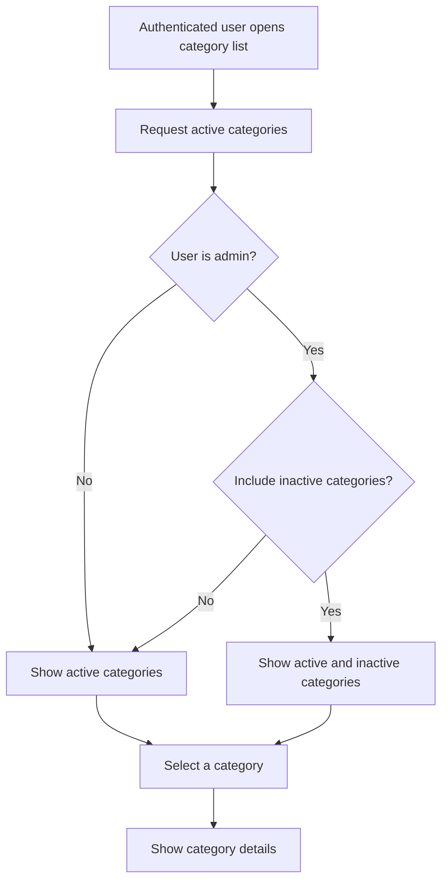

# User Story US002 - Browse Categories

## 1. Description

Provides authenticated users with a catalog of active categories and category details. Admins can also browse inactive categories for catalog maintenance. Category creation and status changes are covered separately.

## 2. User Story Statement

As an authenticated platform user, I want to browse categories so that I can choose or understand valid activity classifications.

## 3. User Flow Diagram

## 4. UX / UI References

- No Figma or wireframe reference is included in EP001.
- Proposed read endpoints are documented in [specification-categories.md](../../specifications/specification-categories.md), section 7.
- The category list and detail presentation are design assumptions pending product design.

## 5. Dependencies

- Blocking: Authenticated identity and role headers supplied through the API gateway.
- Non-blocking: US001 - Manage Category Records, for catalog data.
- No other epic or shared API specification is present in the workspace.

## 6. Personas & Primary Users

- Partner - reads active categories when classifying activities.
- Member - reads active categories when discovering activities.
- Admin - reviews active and inactive catalog entries.

## 7. Acceptance Criteria

| ID  | Given                                                  | When                                                                   | Then                                                                 |
| --- | ------------------------------------------------------ | ---------------------------------------------------------------------- | -------------------------------------------------------------------- |
| AC1 | I am authenticated and active categories exist         | I request the category list without asking to include inactive entries | The response contains active categories only                         |
| AC2 | I am an admin and active and inactive categories exist | I request the category list including inactive entries                 | The response includes both active and inactive categories            |
| AC3 | I am not an admin and inactive categories exist        | I request categories including inactive entries                        | Inactive categories are not included                                 |
| AC4 | I am authenticated and a category exists               | I request that category by code                                        | The response contains its code, name, description, and active status |

## 8. Notes / Additional Information

- EP001 proposes `GET /api/categories` and `GET /api/categories/{code}` for authenticated users.
- The exact query parameter for an admin's inactive-category view is not settled by the proposed interface; the behavior, rather than a parameter name, is specified here.
