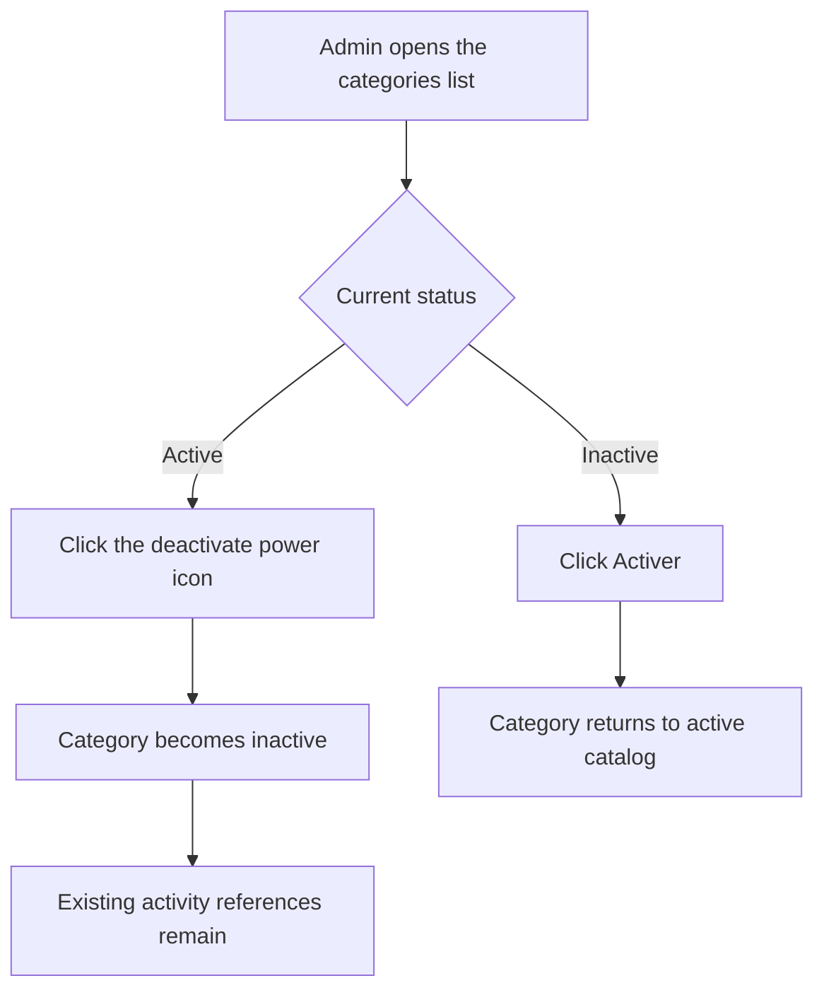

# User Story US003 - Activate or Deactivate a Category

## 1. Description

Allows an admin to change a category's active status. Deactivation removes the category from the selectable active catalog while retaining references on existing activities. Existing references are not rewritten when a category changes status.

## 2. User Story Statement

As an admin, I want to activate or deactivate categories so that I control which classifications can be newly selected.

## 3. User Flow Diagram

## 4. UX / UI References

- No Figma or wireframe reference is included in EP001.
- The status is changed from the admin categories list, like the partners list: an inactive category shows an "Activer" button and an active one shows a "Désactiver" power icon button. A toast confirms "Catégorie activée" or "Catégorie désactivée".
- Proposed status endpoint is documented in [specification-categories.md](../../specifications/specification-categories.md), section 7.

## 5. Dependencies

- Blocking: US001 - Manage Category Records.
- Blocking: Authenticated admin role supplied through the API gateway.
- Related: US004 - Assign a Category to an Activity, which rejects inactive categories for new assignments.

## 6. Personas & Primary Users

- Admin - controls category availability.
- Partner - existing activity references remain associated after deactivation.

## 7. Acceptance Criteria

| ID  | Given                                          | When                              | Then                                                                        |
| --- | ---------------------------------------------- | --------------------------------- | --------------------------------------------------------------------------- |
| AC1 | I am an admin and a category is active         | I deactivate the category         | The category becomes inactive and is excluded from the active category list |
| AC2 | An activity already references the category    | An admin deactivates the category | The existing reference remains associated with that category                |
| AC3 | I am an admin and a category is inactive       | I activate the category           | The category becomes active and is included in the active category list     |
| AC4 | I am not an admin                              | I submit a category status change | The request is rejected with a 403 response                                 |
| AC5 | I am an admin and the category code is unknown | I submit a category status change | The request is rejected with a 404 response                                 |

## 8. Notes / Additional Information

- Deactivation is the supported alternative to deleting a category that may have existing references.
- EP001 proposes `PATCH /api/categories/{code}/status` for status changes; it is implemented as `PATCH /api/categories/{code}/status?active=true|false`, admin-only.
- Only admins can list inactive categories; other users always receive the active ones.
- Rejecting inactive categories on new activity assignments (FR-05) is not implemented here; it belongs to US004.
