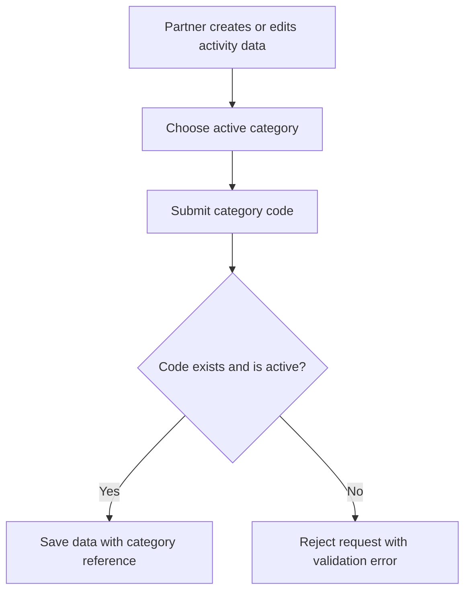

# User Story US004 - Assign a Category to an Activity

## 1. Description

Requires activity create or update operations to use an existing active category code. The category remains a shared catalog reference rather than a free-text label. Partners do not call the categories API (which is admin-only); they submit a category code with the activity create/update request, and partner-service validates it against the catalog. Compatibility for legacy clients that still send category strings is a transition concern noted in EP001 and needs a defined cutover contract.

## 2. User Story Statement

As a partner, I want to select an active category for my activity so that it is classified consistently with the platform catalog.

## 3. User Flow Diagram

## 4. UX / UI References

- No Figma or wireframe reference is included in EP001.
- Category read endpoints and affected activity endpoints are documented in [specification-categories.md](../../specifications/specification-categories.md), sections 7 and 8.

## 5. Dependencies

- Related: US002 - Browse Categories (admin-only; partners do not call the categories API).
- Blocking: US003 - Activate or Deactivate a Category, for active-status validation.
- Blocking: Activity create/update operations in partner-service.
- No other epic or shared API specification is present in the workspace.

## 6. Personas & Primary Users

- Partner - classifies an activity using the shared catalog.

## 7. Acceptance Criteria

| ID  | Given                                                                        | When                                         | Then                                                                            |
| --- | ---------------------------------------------------------------------------- | -------------------------------------------- | ------------------------------------------------------------------------------- |
| AC1 | I am creating or updating an activity and select an existing active category | I submit the record with that category code  | The record is saved with a reference to the selected category                   |
| AC2 | I am creating or updating an activity                                        | I submit a category code that does not exist | The request is rejected with a 400 validation error                             |
| AC3 | I am creating or updating an activity and the selected category is inactive  | I submit the record                          | The request is rejected and the record is not assigned to the inactive category |

## 8. Notes / Additional Information

- EP001 requires validation on activity create/update operations (FR-05); partners no longer have a category. The categories API is admin-only, so partners submit the category code through the activity payload rather than the categories API.
- The spec also calls for existing API clients sending category strings to keep working during a transition (NFR-04), but it does not define the transition period or accepted legacy payload shape. Those details remain open rather than being asserted as acceptance behavior.
