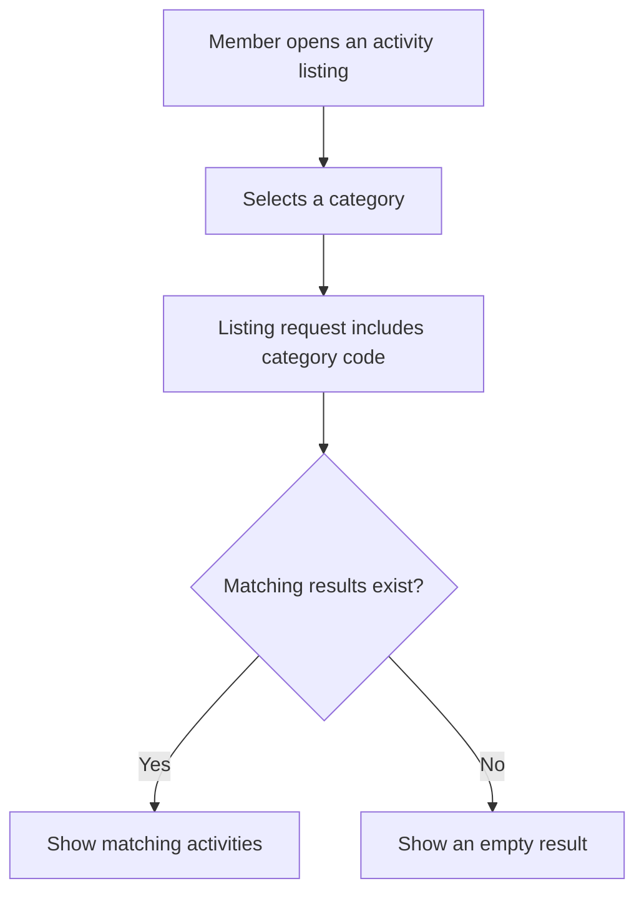

# User Story US005 - Filter Listings by Category

## 1. Description

Allows members and other listing consumers to filter activity results by category code. The returned results match the requested category; listing behavior unrelated to category filtering remains unchanged.

## 2. User Story Statement

As a member, I want to filter activities by category so that I can find offerings in a category I am interested in.

## 3. User Flow Diagram

## 4. UX / UI References

- No Figma or wireframe reference is included in EP001.
- Affected listing endpoints are documented in [specification-categories.md](../../specifications/specification-categories.md), sections 4 and 7.

## 5. Dependencies

- Blocking: US002 - Browse Categories, for available category choices.
- Blocking: Activity listing endpoint.
- No other epic or shared API specification is present in the workspace.

## 6. Personas & Primary Users

- Member - discovers activities and partners.

## 7. Acceptance Criteria

| ID  | Given                                                    | When                                            | Then                                                           |
| --- | -------------------------------------------------------- | ----------------------------------------------- | -------------------------------------------------------------- |
| AC1 | Activities in multiple categories are available          | I filter activities by the `YOGA` category code | Only activities assigned to the matching category are returned |
| AC3 | No listed records are assigned to the requested category | I filter activities by that category code       | The result contains no records                                 |
| AC4 | I request activities without a category filter           | The listing is returned                         | The category filter does not restrict the results              |

## 8. Notes / Additional Information

- EP001 identifies `GET /api/activities` as the affected listing endpoint; `GET /api/partners` no longer filters by category.
- Category matching uses category codes; the spec describes code matching as case-insensitive.
