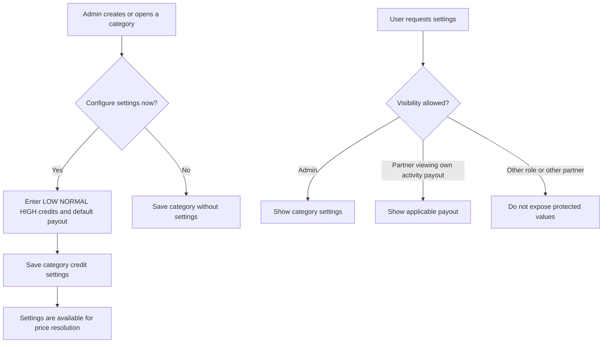

# User Story US006 - Configure Category Credit Settings

## 1. Description

Allows an admin to configure the credit grid and default payout associated with a category. Category setup may offer the admin the option to configure these values at creation time; configuration can also be managed separately. Credit-setting and payout visibility follows the role rules in EP001.

## 2. User Story Statement

As an admin, I want to configure credit and payout values for a category so that class pricing and partner payouts use the appropriate category settings.

## 3. User Flow Diagram

## 4. UX / UI References

- No Figma or wireframe reference is included in EP001.
- Existing credit settings endpoint and fields are documented in [specification-categories.md](../../specifications/specification-categories.md), sections 1, 4, and 7.

## 5. Dependencies

- Blocking: US001 - Manage Category Records.
- Blocking: Credit-service settings API (`/api/credit-settings/{category}`).
- Blocking: Authenticated role and partner identity supplied through the API gateway.
- Related: US007 - Resolve Class Price.

## 6. Personas & Primary Users

- Admin - manages the category credit grid and default payout.
- Partner - may view payout values only for their own activities.

## 7. Acceptance Criteria

| ID  | Given                                                    | When                                                                            | Then                                                             |
| --- | -------------------------------------------------------- | ------------------------------------------------------------------------------- | ---------------------------------------------------------------- |
| AC1 | I am an admin and a category exists                      | I save `creditsLow`, `creditsNormal`, `creditsHigh`, and `defaultPayout` for it | The values are associated with that category's code              |
| AC2 | I am creating a category                                 | I choose to configure credit settings during category setup                     | The category setup flow accepts the four category setting values |
| AC3 | I am an admin and category settings exist                | I request the category's credit settings                                        | The credit grid and payout settings are available to me          |
| AC4 | I am not an admin and I do not own the activity          | I request the category credit grid or payout settings                           | Protected values are not disclosed                               |
| AC5 | I am a partner and the payout belongs to my own activity | I request that activity's payout information                                    | The applicable payout value is visible to me                     |

## 8. Notes / Additional Information

- EP001 does not specify numeric ranges, currency, or validation messages for these values; none are added here.
- Category code matching and pricing keys must remain aligned. `admin-service` owns the category catalog; `credit-service` retains pricing keyed by category code.
