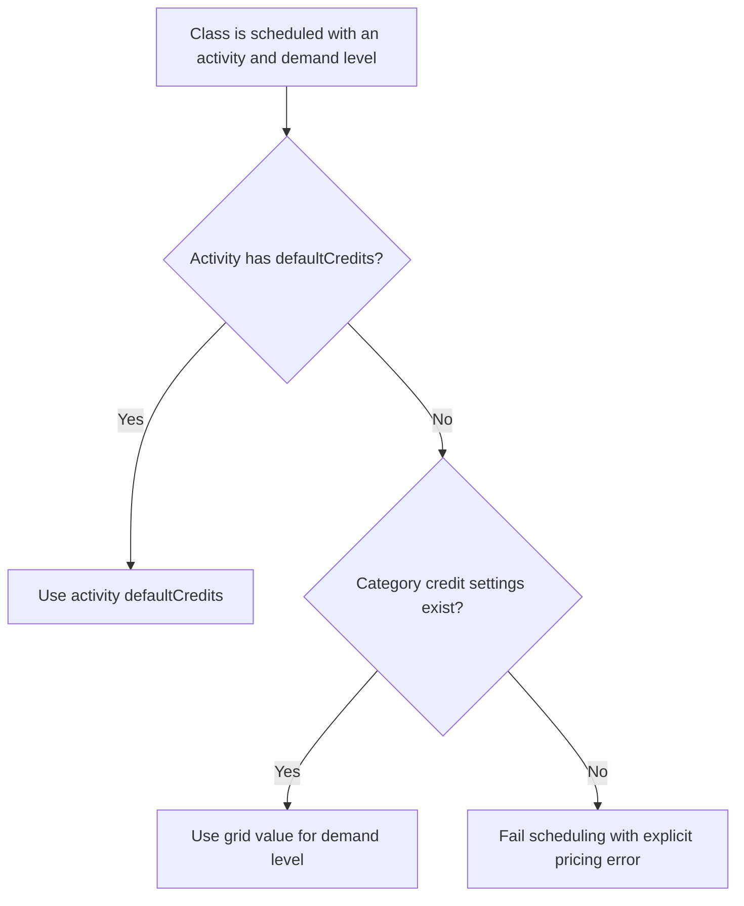

# User Story US007 - Resolve a Class Price

## 1. Description

Resolves class credit cost using the existing precedence rule: an activity's own `defaultCredits` takes priority; otherwise the category credit grid supplies the value for the class demand level. Scheduling fails with an explicit error when it must use the category grid but no settings exist for that category.

## 2. User Story Statement

As the platform, I want to resolve class prices from activity and category settings so that a scheduled class has a defined credit cost.

## 3. User Flow Diagram

## 4. UX / UI References

- No Figma or wireframe reference is included in EP001.
- The pricing precedence and demand levels are documented in [specification-categories.md](../../specifications/specification-categories.md), sections 1 and 5.

## 5. Dependencies

- Blocking: US004 - Assign a Category to an Activity.
- Blocking: US006 - Configure Category Credit Settings, when category pricing is required.
- Blocking: Planning-service class scheduling and credit-service price lookup.
- No other epic or shared API specification is present in the workspace.

## 6. Personas & Primary Users

- Platform scheduling flow - resolves the class credit cost for downstream booking and member display.

## 7. Acceptance Criteria

| ID  | Given                                                                 | When                                    | Then                                                                                          |
| --- | --------------------------------------------------------------------- | --------------------------------------- | --------------------------------------------------------------------------------------------- |
| AC1 | The activity has `defaultCredits` and category settings also exist    | A class is scheduled at `LOW` demand    | The class cost is the activity's `defaultCredits` value                                       |
| AC2 | The activity has no `defaultCredits` and its category has settings    | A class is scheduled at `LOW` demand    | The class cost is `creditsLow`                                                                |
| AC3 | The activity has no `defaultCredits` and its category has settings    | A class is scheduled at `NORMAL` demand | The class cost is `creditsNormal`                                                             |
| AC4 | The activity has no `defaultCredits` and its category has settings    | A class is scheduled at `HIGH` demand   | The class cost is `creditsHigh`                                                               |
| AC5 | The activity has no `defaultCredits` and its category has no settings | A class is scheduled                    | Scheduling fails with an explicit error indicating that category pricing settings are missing |

## 8. Notes / Additional Information

- Price resolution precedence is unchanged from BR-02.
- EP001 requires an explicit error instead of a silent default when category pricing is missing (BR-03); exact error text is not specified.
