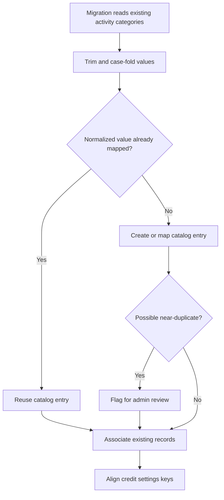

# User Story US008 - Migrate Legacy Category Values

## 1. Description

Converts existing free-text category values on activities into catalog references. Values are normalized by trimming surrounding whitespace and case-folding; equivalent normalized values map to a catalog entry. Existing credit-setting keys are aligned with the resulting category codes, and near-duplicates are surfaced for admin review.

## 2. User Story Statement

As a platform administrator, I want existing category values reconciled with the managed catalog so that current activity data continues to use valid categories.

## 3. User Flow Diagram

## 4. UX / UI References

- No Figma or wireframe reference is applicable to the migration flow.
- Migration requirements and data sources are documented in [specification-categories.md](../../specifications/specification-categories.md), sections 4 and 9.

## 5. Dependencies

- Blocking: US001 - Manage Category Records, for catalog records.
- Blocking: US004 - Assign a Category to an Activity, for the resulting reference contract.
- Blocking: US006 - Configure Category Credit Settings, for aligning existing pricing keys.
- No other epic or shared API specification is present in the workspace.

## 6. Personas & Primary Users

- Platform administrator - reviews ambiguous near-duplicate mappings.
- Platform migration process - reconciles existing records and pricing keys.

## 7. Acceptance Criteria

| ID  | Given                                                                                 | When                                               | Then                                                                                   |
| --- | ------------------------------------------------------------------------------------- | -------------------------------------------------- | -------------------------------------------------------------------------------------- |
| AC1 | Activity records contain legacy category strings                                      | The category migration processes those records     | Each normalized distinct value has a corresponding catalog entry                       |
| AC2 | Multiple legacy values differ only by surrounding whitespace or letter case           | The category migration processes those values      | They map to the same normalized catalog entry                                          |
| AC3 | Legacy category values are similar but not equivalent after trimming and case-folding | The migration identifies a possible near-duplicate | The value is flagged for admin review rather than silently merged                      |
| AC4 | Existing records have category values and credit settings are keyed by legacy strings | The migration completes the category mapping       | Activity references and credit-setting keys correspond to the resulting category codes |

## 8. Notes / Additional Information

- The precise near-duplicate detection and review-resolution rules are not defined by EP001 and remain open.
- The functional criteria describe mapping outcomes; migration idempotence, reversibility, and operational execution are specified as non-functional requirements in the epic and are not restated as acceptance criteria.
