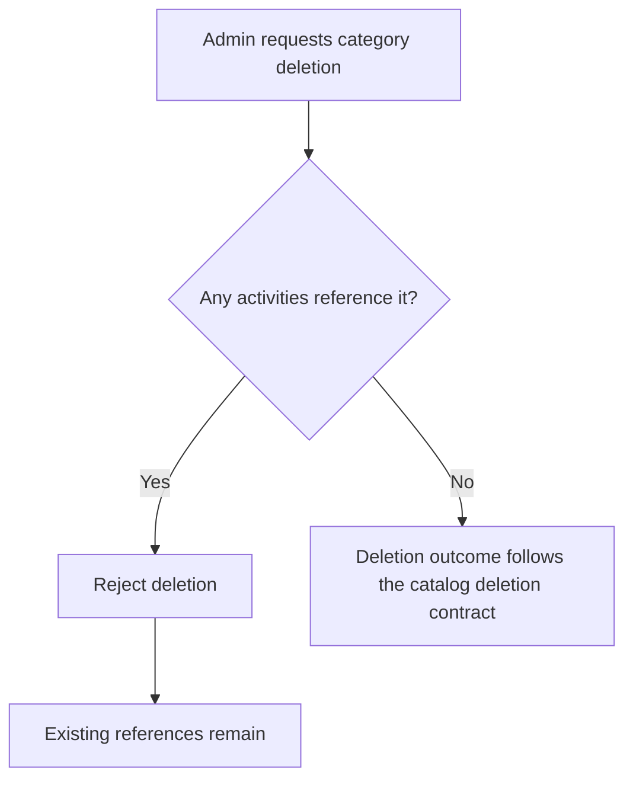

# User Story US009 - Protect Referenced Categories from Deletion

## 1. Description

Prevents deletion of a category while any activity references it. Admins use deactivation to remove an in-use category from new selections without breaking existing references. Deletion behavior for unreferenced categories is not defined by this story.

## 2. User Story Statement

As an admin, I want referenced categories protected from deletion so that existing activity classifications remain valid.

## 3. User Flow Diagram

## 4. UX / UI References

- No Figma or wireframe reference is included in EP001.
- The reference constraint and deactivation alternative are documented in [specification-categories.md](../../specifications/specification-categories.md), sections 4 and 5.

## 5. Dependencies

- Blocking: US001 - Manage Category Records.
- Blocking: Partner-service activity category reference checks.
- Blocking: Authenticated admin role supplied through the API gateway.
- Related: US003 - Activate or Deactivate a Category.

## 6. Personas & Primary Users

- Admin - maintains catalog integrity.
- Partner and member - benefit from existing classifications remaining valid.

## 7. Acceptance Criteria

| ID  | Given                                             | When                                           | Then                                                                    |
| --- | ------------------------------------------------- | ---------------------------------------------- | ----------------------------------------------------------------------- |
| AC1 | A category is referenced by at least one activity | An admin requests deletion of the category     | The deletion is rejected and the activity reference remains intact      |
| AC2 | A category is referenced by several activities    | An admin requests deletion of the category     | The deletion is rejected and all activity references remain intact      |
| AC3 | A category is referenced by an activity           | An admin needs to stop new use of the category | The category can be deactivated while existing references remain intact |

## 8. Notes / Additional Information

- FR-09 specifies the guard for referenced categories but EP001's proposed endpoint list does not define a delete endpoint or behavior for an unreferenced category. That API contract remains an open implementation decision.
