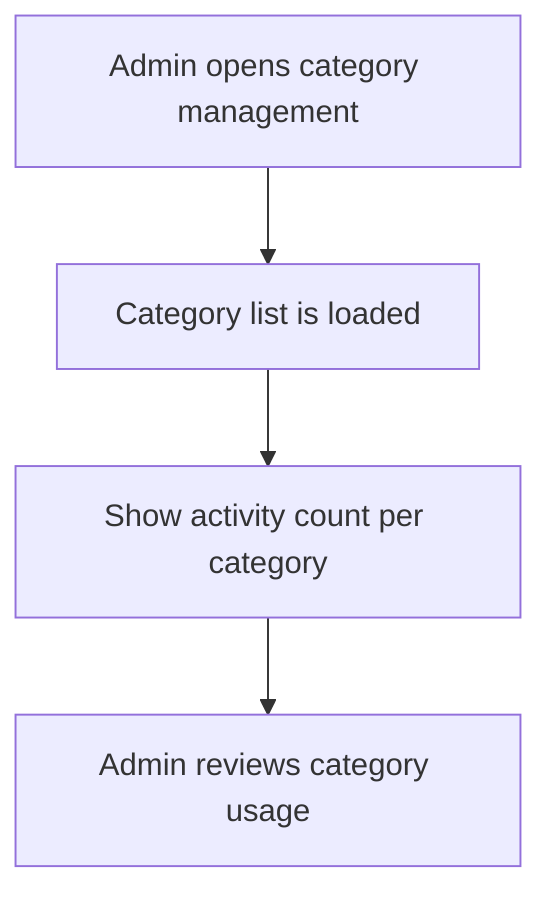

# User Story US010 - View Category Usage Counts

## 1. Description

Shows admins the number of activities associated with each category. Counts help admins understand catalog usage when reviewing or maintaining category records. The story does not define additional analytics or historical counts.

## 2. User Story Statement

As an admin, I want to see activity usage counts for each category so that I can understand where categories are in use.

## 3. User Flow Diagram

## 4. UX / UI References

- No Figma or wireframe reference is included in EP001.
- The usage-count requirement is FR-11 in [specification-categories.md](../../specifications/specification-categories.md).
- Presentation details remain pending product design.

## 5. Dependencies

- Blocking: US001 - Manage Category Records.
- Blocking: Activity category references in partner-service.
- Blocking: Admin role supplied through the API gateway.
- No other epic or shared API specification is present in the workspace.

## 6. Personas & Primary Users

- Admin - reviews category usage during catalog maintenance.

## 7. Acceptance Criteria

| ID  | Given                                                   | When                                    | Then                                   |
| --- | ------------------------------------------------------- | --------------------------------------- | -------------------------------------- |
| AC1 | I am an admin and categories have activity references   | I view the category catalog             | Each category shows its activity count |
| AC2 | I am an admin and a category has no activity references | I view the category catalog             | The category shows zero activities     |
| AC3 | I am not an admin                                       | I request the admin category usage view | Usage counts are not exposed to me     |

## 8. Notes / Additional Information

- This implements the epic's "Could" priority requirement FR-11.
- EP001 does not define count refresh timing, so no timing threshold is specified.
