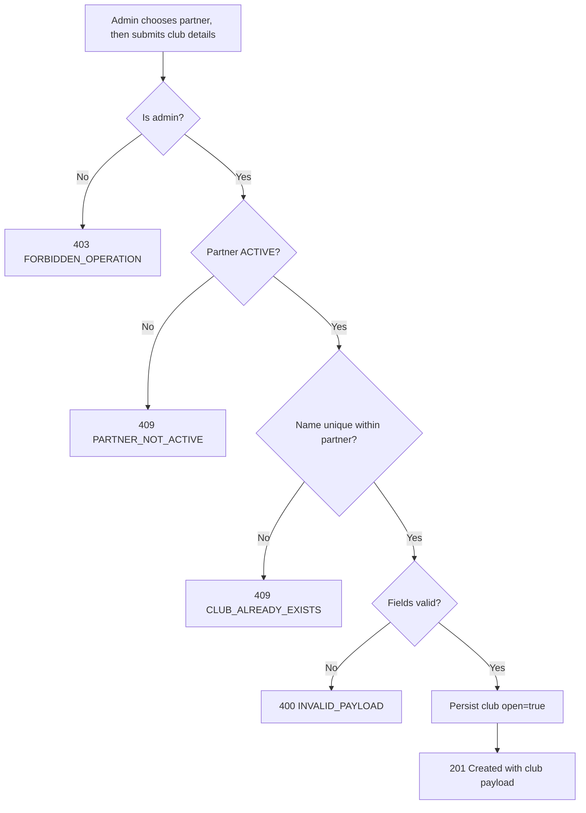

# User Story US001 - Create a Club

## 1. Description

Allows an admin to register a new physical site (club) under an existing partner. The operator first chooses the partner the club belongs to (`partnerId`). The club is created with `open = true`. The name is mandatory and unique within the partner; the address fields are mandatory, while geolocation (`latitude`/`longitude`), description and contact are optional. The caller must have an admin role, and the partner must be `ACTIVE`.

## 2. User Story Statement

As an admin, I want to choose the partner a club belongs to and register the club so that the partner's activities have a defined site where they take place.

## 3. User Flow Diagram

## 4. UX / UI References

- Backend API only in this epic; no dedicated screen yet.
- Design system: Onshore design system (club management screens pending).
- TODO: Figma link for the "Create club" form once available.

## 5. Dependencies

- Blocking: EP002 Partners — `Partner` entity and `ACTIVE` status in partner-service.
- Blocking: `common-lib` embeddables `Address` and `ContactPerson`; new `GeoLocation` embeddable.
- Blocking: api-gateway route for `/api/clubs/**`.
- Non-blocking: EP001 Categories — activity↔category link (not needed for club creation).

## 6. Personas & Primary Users

- Admin — registers clubs for any partner.

## 7. Acceptance Criteria

| ID   | Given                                                                         | When                            | Then                                                                                             |
| ---- | ----------------------------------------------------------------------------- | ------------------------------- | ------------------------------------------------------------------------------------------------ |
| AC1  | I am an admin                                                                 | I create a club                 | I first choose the partner the club belongs to                                                   |
| AC2  | I am an admin and the chosen partner is `ACTIVE`                              | I submit valid mandatory fields | A club is created with `open = true` and the response contains `id`, `partnerId` and `createdAt` |
| AC3  | I am not an admin                                                             | I create a club                 | The request is rejected with 403 `FORBIDDEN_OPERATION`                                           |
| AC4  | The chosen partner is not `ACTIVE`                                            | I create a club for it          | The request is rejected with 409 `PARTNER_NOT_ACTIVE`                                            |
| AC5  | The club name is already used by the same partner                             | I create a club with that name  | The request is rejected with 409 `CLUB_ALREADY_EXISTS`                                           |
| AC6  | Another partner already uses the same name                                    | I create a club with that name  | The club is created (names are unique per partner only)                                          |
| AC7  | A mandatory field (`name`, `street`, `city` or `zipCode`) is missing          | I create a club                 | The request is rejected with 400 `INVALID_PAYLOAD`                                               |
| AC8  | I omit `latitude` and `longitude`                                             | I create a club                 | The club is created without geographical coordinates                                             |
| AC9  | I provide `latitude` outside `[-90, 90]` or `longitude` outside `[-180, 180]` | I create a club                 | The request is rejected with 400 `INVALID_PAYLOAD`                                               |
| AC10 | I provide a `contactEmail` that is not well formed                            | I create a club                 | The request is rejected with 400 `INVALID_PAYLOAD`                                               |

## 8. Notes / Additional Information

- Error responses follow the RFC 9457 envelope shared by all services.
- Geolocation is optional (R-02); a club without coordinates is valid.
- Endpoint style is flat `/api/clubs` (R-01).
- No club deletion in this epic; deletion is guarded while activities reference it (BR-05).
