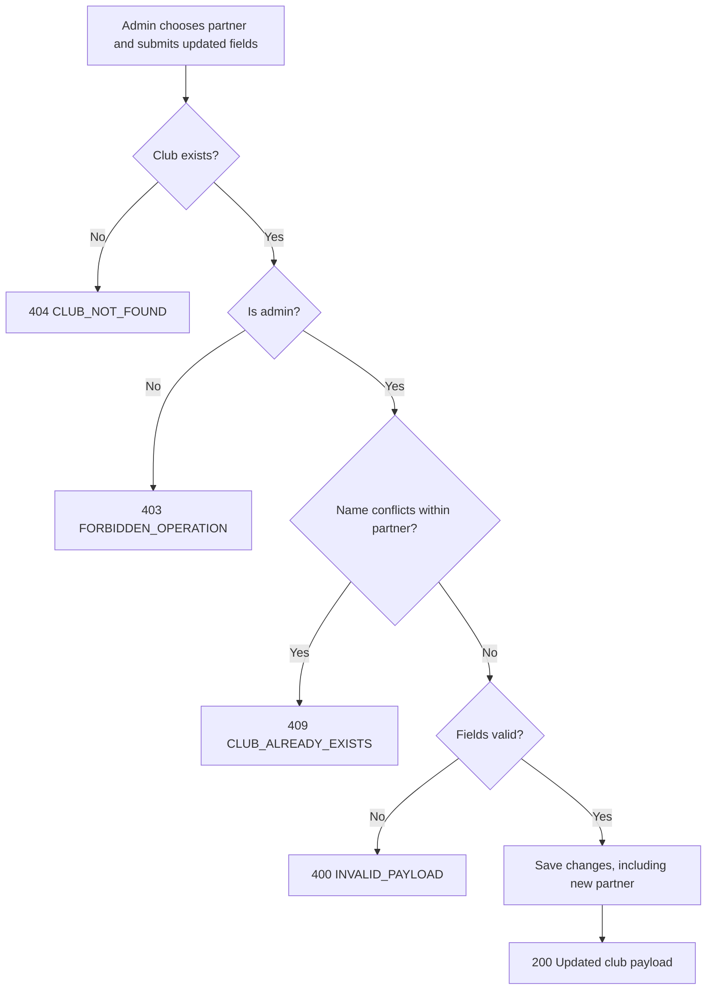

# User Story US002 - Update a Club Profile

## 1. Description

Allows an admin to update a club's editable fields: name, description, address, geolocation, contact and the partner it belongs to. An admin can move the club to another partner during the update. Only admins may update a club.

## 2. User Story Statement

As an admin, I want to update a club's details, including the partner it belongs to, so that the site information stays accurate.

## 3. User Flow Diagram

## 4. UX / UI References

- Backend API only in this epic; no dedicated screen yet.
- Design system: Onshore design system (club management screens pending).
- TODO: Figma link for the "Edit club" form once available.

## 5. Dependencies

- Blocking: US001 - Create a Club (a club must exist).
- Blocking: EP002 Partners — `Partner` entity.
- Blocking: api-gateway route for `/api/clubs/**`.

## 6. Personas & Primary Users

- Admin — keeps club details current.

## 7. Acceptance Criteria

| ID  | Given                                                  | When              | Then                                                             |
| --- | ------------------------------------------------------ | ----------------- | ---------------------------------------------------------------- |
| AC1 | I am an admin                                          | I update a club   | The changes are saved, including the partner the club belongs to |
| AC2 | I am an admin and choose a different partner           | I update a club   | The club is moved to that partner                                |
| AC3 | I am not an admin                                      | I update a club   | The request is rejected with 403 `FORBIDDEN_OPERATION`           |
| AC4 | The club id is unknown                                 | I update it       | The request is rejected with 404 `CLUB_NOT_FOUND`                |
| AC5 | I set the name to one already used by the same partner | I update the club | The request is rejected with 409 `CLUB_ALREADY_EXISTS`           |
| AC6 | I provide `latitude` or `longitude` out of range       | I update the club | The request is rejected with 400 `INVALID_PAYLOAD`               |
| AC7 | I provide a `contactEmail` that is not well formed     | I update the club | The request is rejected with 400 `INVALID_PAYLOAD`               |

## 8. Notes / Additional Information

- `partnerId` can be changed during an update (BR-01); an admin can move the club to another partner.
- Error responses follow the RFC 9457 envelope shared by all services.
- Geolocation is optional (R-02); omitting it on update keeps the existing values.
