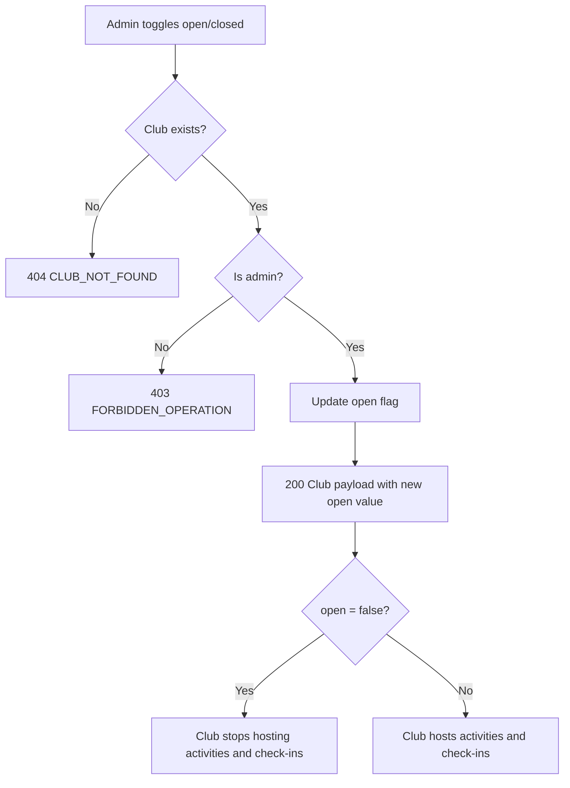

# User Story US003 - Open and Close a Club

## 1. Description

Allows an admin to toggle a club's `open` flag via `PATCH /api/clubs/{clubId}/open?open=`. Closing a club stops it from hosting activities and check-ins without deleting it; reopening restores it with all data intact.

## 2. User Story Statement

As an admin, I want to close and reopen a club so that temporarily unavailable sites stop hosting activities and check-ins.

## 3. User Flow Diagram

## 4. UX / UI References

- Backend API only in this epic; no dedicated screen yet.
- Design system: Onshore design system (club management screens pending).
- TODO: Figma link for the open/close toggle once available.

## 5. Dependencies

- Blocking: US001 - Create a Club (a club must exist).
- Blocking: EP002 Partners — `Partner` entity.
- Blocking: api-gateway route for `/api/clubs/**`.

## 6. Personas & Primary Users

- Admin — manages the availability of any club.

## 7. Acceptance Criteria

| ID  | Given                                  | When                       | Then                                                                   |
| --- | -------------------------------------- | -------------------------- | ---------------------------------------------------------------------- |
| AC1 | A club is `open`                       | I close it                 | The club is saved as closed and stops hosting activities and check-ins |
| AC2 | A club is closed                       | I reopen it                | The club is `open` again with its data intact                          |
| AC3 | I am an admin                          | I toggle the club          | The change is saved                                                    |
| AC4 | I am not an admin                      | I toggle the club          | The request is rejected with 403 `FORBIDDEN_OPERATION`                 |
| AC5 | The club id is unknown                 | I toggle it                | The request is rejected with 404 `CLUB_NOT_FOUND`                      |
| AC6 | I omit or send an invalid `open` value | I call the toggle endpoint | The request is rejected with 400 `INVALID_PAYLOAD`                     |

## 8. Notes / Additional Information

- Closing keeps the club's data and history (BR-04); it never deletes the club.
- Error responses follow the RFC 9457 envelope shared by all services.
