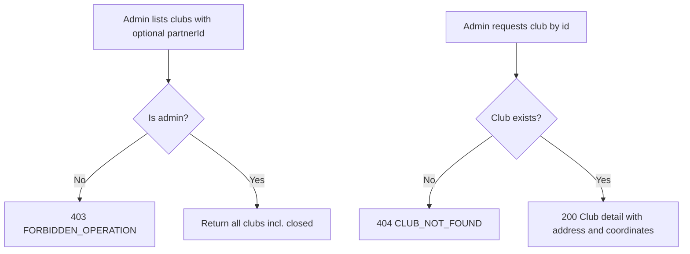

# User Story US004 - Browse and View Clubs

## 1. Description

Allows admins to list clubs (filterable by `partnerId`) and view a club's details. All clubs are returned, including closed ones.

## 2. User Story Statement

As an admin, I want to browse and filter clubs so that I can review and manage the sites.

## 3. User Flow Diagram

## 4. UX / UI References

- Backend API only in this epic; no dedicated screen yet.
- Design system: Onshore design system (club listing and detail screens pending).
- TODO: Figma links for the club list and detail once available.

## 5. Dependencies

- Blocking: US001 - Create a Club (clubs must exist).
- Blocking: EP002 Partners — `Partner` entity.
- Blocking: api-gateway route for `/api/clubs/**`.

## 6. Personas & Primary Users

- Admin — reviews and manages all sites.

## 7. Acceptance Criteria

| ID  | Given                                                   | When                                 | Then                                                   |
| --- | ------------------------------------------------------- | ------------------------------------ | ------------------------------------------------------ |
| AC1 | I am an admin and clubs exist                           | I list clubs                         | All clubs are returned, including closed ones          |
| AC2 | I am an admin and clubs of several partners exist       | I list clubs filtered by `partnerId` | Only the clubs of that partner are returned            |
| AC3 | I am an admin and no clubs match the `partnerId` filter | I list clubs                         | An empty list is returned                              |
| AC4 | A club exists                                           | I request it by id                   | I get its details, address and coordinates             |
| AC5 | The club id is unknown                                  | I request it                         | The request is rejected with 404 `CLUB_NOT_FOUND`      |
| AC6 | I am not an admin                                       | I list or request clubs              | The request is rejected with 403 `FORBIDDEN_OPERATION` |

## 8. Notes / Additional Information

- Club APIs are admin-only (BR-03); there is no public club listing.
- Error responses follow the RFC 9457 envelope shared by all services.
