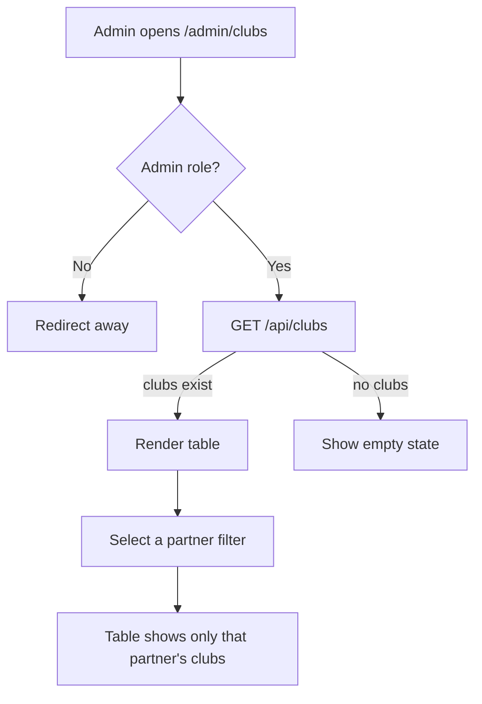

# User Story US001 - Browse and Filter Clubs

## 1. Description

Admin-only page at `/admin/clubs` that lists every club and lets an operator filter by partner. It reuses the existing `AdminShell` + table pattern (like `AdminCategories`) with an empty state and an error banner. Non-admins cannot reach the page.

## 2. User Story Statement

As an admin, I want to browse and filter clubs so that I can review and manage all the sites of the platform.

## 3. User Flow Diagram

## 4. UX / UI References

- Design system: Onshore design system (club list screen pending).
- Components: `PageHeader`, `EmptyState`, `ErrorBanner`, `Badge`, table.
- Navigation: `AdminShell` link "Clubs" with the `MapPin` icon.
- TODO: Figma link for the club list once available.

## 5. Dependencies

- Blocking: EP003 Clubs backend — `GET /api/clubs` (admin-only).
- Blocking: `ROLE_SYSTEM_ADMIN` route protection via `ProtectedRoute` and `AdminShell`.
- Blocking: `adminSlice.partners` (partner list) for the filter options.
- Blocking: `src/services/clubService.js` `listClubs` + `adminSlice.fetchClubs`.

## 6. Personas & Primary Users

- Admin — reviews and manages all sites.

## 7. Acceptance Criteria

| ID  | Given                               | When                     | Then                                               |
| --- | ----------------------------------- | ------------------------ | -------------------------------------------------- |
| AC1 | I am an admin on `/admin/clubs`     | The page loads           | The list of clubs is displayed (or an empty state) |
| AC2 | I am not an admin                   | I open `/admin/clubs`    | I am redirected and cannot access the page         |
| AC3 | Clubs of several partners exist     | I filter by a partner    | Only that partner's clubs are shown                |
| AC4 | No clubs match the selected partner | I filter by that partner | An empty state is shown                            |
| AC5 | The request fails                   | The page loads           | An error message is shown via the error banner     |

## 8. Notes / Additional Information

- Club APIs are admin-only (BR-03); there is no public club listing.
- The list + modal pattern is used in v1; a dedicated detail page is deferred.
- Error responses follow the RFC 9457 envelope surfaced by `ApiError`.
