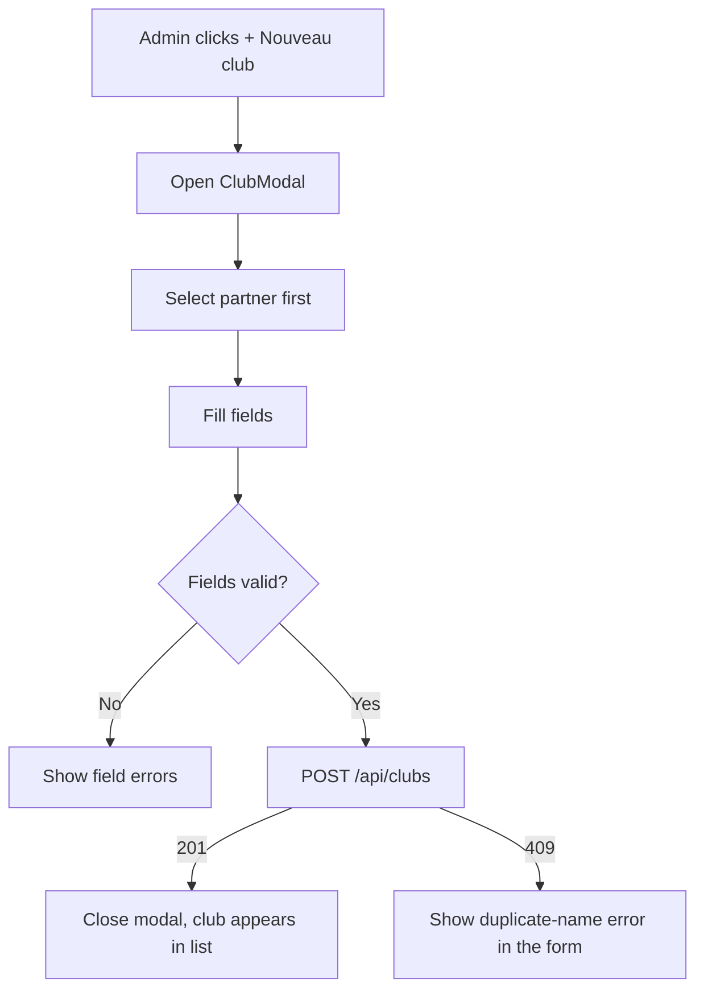

# User Story US002 - Create a Club

## 1. Description

Admin creates a club from a modal on `/admin/clubs`. The operator first chooses the partner the club belongs to, then fills the mandatory fields (`name`, `street`, `city`, `zipCode`) and optional fields (`latitude`, `longitude`, `description`, contact). Client-side validation runs before the request; on success the club appears in the list.

## 2. User Story Statement

As an admin, I want to create a club under a chosen partner so that the platform's sites are registered.

## 3. User Flow Diagram

## 4. UX / UI References

- Design system: Onshore design system (club create form pending).
- Components: `Modal`, `Field`, `Input`, `Textarea`, `Select`, `Button`, `Toaster`.
- TODO: Figma link for the "Create club" form once available.

## 5. Dependencies

- Blocking: EP003 Clubs backend — `POST /api/clubs`.
- Blocking: `adminSlice.partners` (partner list) for the partner selector.
- Blocking: US001 - Browse and Filter Clubs (the page hosting the modal).
- Blocking: `src/services/clubService.js` `createClub` + `adminSlice.saveClub`.

## 6. Personas & Primary Users

- Admin — registers clubs for any partner.

## 7. Acceptance Criteria

| ID  | Given                                              | When                                  | Then                                                                 |
| --- | -------------------------------------------------- | ------------------------------------- | -------------------------------------------------------------------- |
| AC1 | I am an admin                                      | I click "+ Nouveau club"              | The modal opens with the partner selector first                      |
| AC2 | I choose a partner and fill valid mandatory fields | I submit the form                     | The club is created under the chosen partner and appears in the list |
| AC3 | I do not choose a partner                          | I submit the form                     | A validation error is shown and no request is sent                   |
| AC4 | A mandatory field is missing                       | I submit the form                     | Field errors are shown and no request is sent                        |
| AC5 | I enter latitude/longitude out of range            | I submit the form                     | A validation error is shown and no request is sent                   |
| AC6 | I enter a malformed contact email                  | I submit the form                     | A validation error is shown and no request is sent                   |
| AC7 | The backend returns 409 `CLUB_ALREADY_EXISTS`      | I create a club with a duplicate name | The error is displayed in the form                                   |
| AC8 | A request is in progress                           | I submit the form                     | The submit button is disabled to prevent duplicate submissions       |

## 8. Notes / Additional Information

- Geolocation is optional; empty coordinates are allowed.
- Partner selection is the first step, per the EP003 creation flow.
- API errors surface through `ApiError` (RFC 9457) and the global toast pattern.
