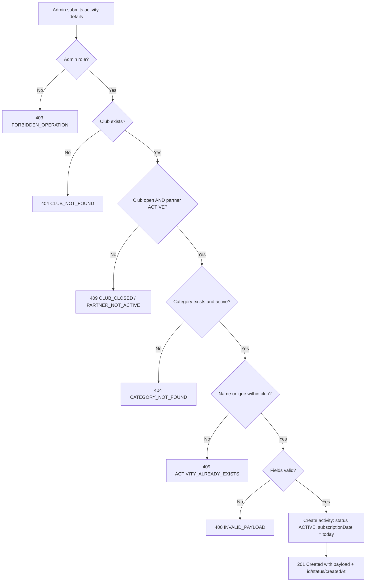

# User Story US001 - Create an Activity

## 1. Description

Allows an admin to register a new activity under an existing club and category. The activity is created with status `ACTIVE`, and its partner is derived from the chosen club. `clubId`, `name` and `categoryId` are mandatory; `description` and the instructor contact fields are optional; `subscriptionDate` defaults to the creation date. The club must be `open` and its partner `ACTIVE`, the category must exist and be active, and the name must be unique within the club.

## 2. User Story Statement

As an admin, I want to register an activity for a club with a category so that it is offered on the platform.

## 3. User Flow Diagram

## 4. UX / UI References

- Backend API only in this epic; no dedicated screen yet.
- Design system: Onshore design system (activity screens pending).
- TODO: Figma link for the "Create activity" form once available.

## 5. Dependencies

- Blocking: EP003 Clubs — `Club` entity, `open` flag and club lookup.
- Blocking: EP001 Categories — category catalog with `active` flag.
- Blocking: EP002 Partners — `ACTIVE` partner status (the activity's partner is derived from the club).
- Blocking: `common-lib` `ContactPerson` embeddable reused for the instructor.
- Blocking: api-gateway route for `/api/activities/**`.

## 6. Personas & Primary Users

- Admin — registers activities for any club.

## 7. Acceptance Criteria

| ID   | Given                                                                                    | When                                                              | Then                                                                                                                                                |
| ---- | ---------------------------------------------------------------------------------------- | ----------------------------------------------------------------- | --------------------------------------------------------------------------------------------------------------------------------------------------- |
| AC1  | I am an admin and the club is `open` with an `ACTIVE` partner and the category is active | I create an activity with valid `clubId`, `name` and `categoryId` | The activity is created with status `ACTIVE`, `subscriptionDate` set to the creation date, and the response contains `id`, `status` and `createdAt` |
| AC2  | I am an admin and the club is closed                                                     | I create an activity for that club                                | The request is rejected with 409 `CLUB_CLOSED`                                                                                                      |
| AC3  | I am an admin and the club's partner is not `ACTIVE`                                     | I create an activity for that club                                | The request is rejected with 409 `PARTNER_NOT_ACTIVE`                                                                                               |
| AC4  | I am an admin and the `clubId` does not match any club                                   | I create an activity                                              | The request is rejected with 404 `CLUB_NOT_FOUND`                                                                                                   |
| AC5  | I am an admin and the `categoryId` is unknown or its category is inactive                | I create an activity                                              | The request is rejected with 404 `CATEGORY_NOT_FOUND`                                                                                               |
| AC6  | I am an admin and the `name` is already used by another activity of the same club        | I create an activity with that name                               | The request is rejected with 409 `ACTIVITY_ALREADY_EXISTS`                                                                                          |
| AC7  | I am an admin and a mandatory field (`clubId`, `name` or `categoryId`) is missing        | I create an activity                                              | The request is rejected with 400 `INVALID_PAYLOAD`                                                                                                  |
| AC8  | I am an admin and I provide an `instructorEmail` that is not well formed                 | I create an activity                                              | The request is rejected with 400 `INVALID_PAYLOAD`                                                                                                  |
| AC9  | I omit `description` and the instructor contact fields                                   | I create an activity                                              | The activity is created without those optional fields                                                                                               |
| AC10 | The `name` is already used by an activity of a different club                            | I create an activity with that name                               | The activity is created (names are unique per club only)                                                                                            |
| AC11 | I am not an admin                                                                        | I create an activity                                              | The request is rejected with 403 `FORBIDDEN_OPERATION`                                                                                              |

## 8. Notes / Additional Information

- The partner of the activity is derived from the club; it is not stored on the activity itself (BR-03).
- `subscriptionDate` is system-set to the creation date when not provided (FR-03).
- Error responses follow the RFC 9457 envelope shared by all services.
- Legacy columns (`partnerId`, `category`, `durationMinutes`, `partnerPayout`, `defaultCredits`, `active`) are dropped and are not part of the create payload.
- Out of scope: legacy pricing/credit columns and the migration of their values (reviewed separately).
