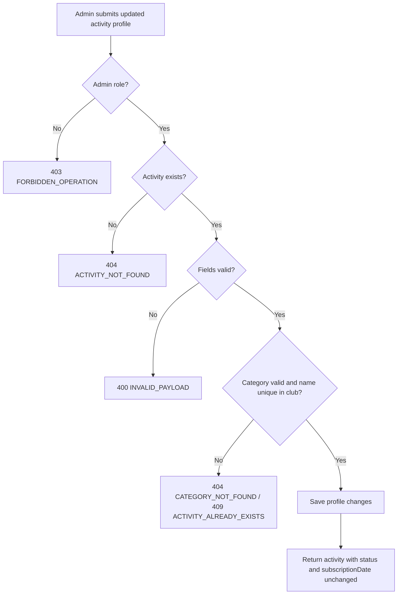

# User Story US002 - Update an Activity Profile

## 1. Description

Allows an admin to edit an activity's profile: `name`, `description`, `categoryId`, the instructor contact fields and, optionally, the club it belongs to. The update never changes the activity's `status` or `subscriptionDate`; any `status` or `subscriptionDate` sent in the payload is ignored. Only admins can update an activity, and the creation-time validation rules still apply.

## 2. User Story Statement

As an admin, I want to edit an activity's information so that it stays current.

## 3. User Flow Diagram

## 4. UX / UI References

- Backend API only in this epic; no dedicated screen yet.
- Design system: Onshore design system (activity screens pending).
- TODO: Figma link for the "Edit activity" form once available.

## 5. Dependencies

- Blocking: EP003 Clubs — `Club` entity and club lookup for the optional club move.
- Blocking: EP001 Categories — category catalog for `categoryId` validation.
- Blocking: EP002 Partners — the partner is derived from the club.
- Blocking: `common-lib` `ContactPerson` embeddable reused for the instructor.
- Blocking: api-gateway route for `/api/activities/**`.

## 6. Personas & Primary Users

- Admin — keeps activity information current.

## 7. Acceptance Criteria

| ID  | Given                                                                                      | When                                    | Then                                                                                          |
| --- | ------------------------------------------------------------------------------------------ | --------------------------------------- | --------------------------------------------------------------------------------------------- |
| AC1 | I am an admin and an activity exists                                                       | I update its profile with valid changes | The changes are saved and the activity's `status` and `subscriptionDate` are unchanged        |
| AC2 | I include `status` or `subscriptionDate` in the update payload                             | I submit the update                     | Those fields are ignored and the stored values remain unchanged                               |
| AC3 | I am an admin and I set an `instructorEmail` that is not well formed                       | I update the activity                   | The request is rejected with 400 `INVALID_PAYLOAD`                                            |
| AC4 | I am an admin and I change `categoryId` to an unknown or inactive category                 | I update the activity                   | The request is rejected with 404 `CATEGORY_NOT_FOUND`                                         |
| AC5 | I am an admin and I change `name` to one already used by another activity of the same club | I update the activity                   | The request is rejected with 409 `ACTIVITY_ALREADY_EXISTS`                                    |
| AC6 | I am an admin and I change the club to another club of the same partner                    | I update the activity                   | The activity is moved to that club                                                            |
| AC7 | I am an admin and I change the club to a club of a different partner                       | I update the activity                   | The request is rejected with an error indicating the club does not belong to the same partner |
| AC8 | I am not an admin                                                                          | I update an activity                    | The request is rejected with 403 `FORBIDDEN_OPERATION`                                        |

## 8. Notes / Additional Information

- `status` and `subscriptionDate` cannot be set through the profile update (BR-05); status changes go through `PATCH /status`.
- Moving to another club is allowed only within the same partner (FR-13, Could priority).
- The partner of the activity remains derived from the club; it is never stored or updated directly (BR-03).
