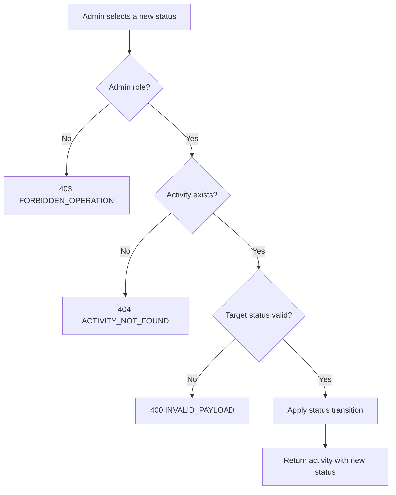

# User Story US003 - Change an Activity Status

## 1. Description

Allows an admin to suspend, reject or reactivate an activity through `PATCH /api/activities/{id}/status`. `ACTIVE` and `SUSPENDED` can be toggled back and forth; `REJECTED` is not terminal and can transition to `ACTIVE` or `SUSPENDED`. Status changes keep the activity's data and history so existing classes and bookings remain traceable.

## 2. User Story Statement

As an admin, I want to suspend or reject an activity so that it stops being offered, and reactivate it when appropriate.

## 3. User Flow Diagram

## 4. UX / UI References

- Backend API only in this epic; no dedicated screen yet.
- Design system: Onshore design system (activity screens pending).

## 5. Dependencies

- Blocking: EP003 Clubs, EP001 Categories and EP002 Partners — the activity must exist with valid references before a status change.
- Blocking: api-gateway route for `/api/activities/**`.

## 6. Personas & Primary Users

- Admin — moderates the activity lifecycle.

## 7. Acceptance Criteria

| ID  | Given                                               | When                                           | Then                                                     |
| --- | --------------------------------------------------- | ---------------------------------------------- | -------------------------------------------------------- |
| AC1 | An activity is `ACTIVE`                             | I suspend it                                   | Its status becomes `SUSPENDED`                           |
| AC2 | An activity is `SUSPENDED`                          | I reactivate it                                | Its status becomes `ACTIVE` again and its data is intact |
| AC3 | An activity has any status                          | I set its status to `REJECTED`                 | Its status becomes `REJECTED`                            |
| AC4 | An activity is `REJECTED`                           | I change its status to `ACTIVE` or `SUSPENDED` | Its status moves to that value                           |
| AC5 | I am an admin and I provide an invalid status value | I change the status                            | The request is rejected with 400 `INVALID_PAYLOAD`       |
| AC6 | I am not an admin                                   | I change an activity's status                  | The request is rejected with 403 `FORBIDDEN_OPERATION`   |

## 8. Notes / Additional Information

- `REJECTED` is not terminal (FR-11, Should priority); transitions from `REJECTED` to `ACTIVE` or `SUSPENDED` are allowed.
- Suspending or rejecting keeps the activity's data and history (BR-06).
- Status changes record who and when (NFR-04).
