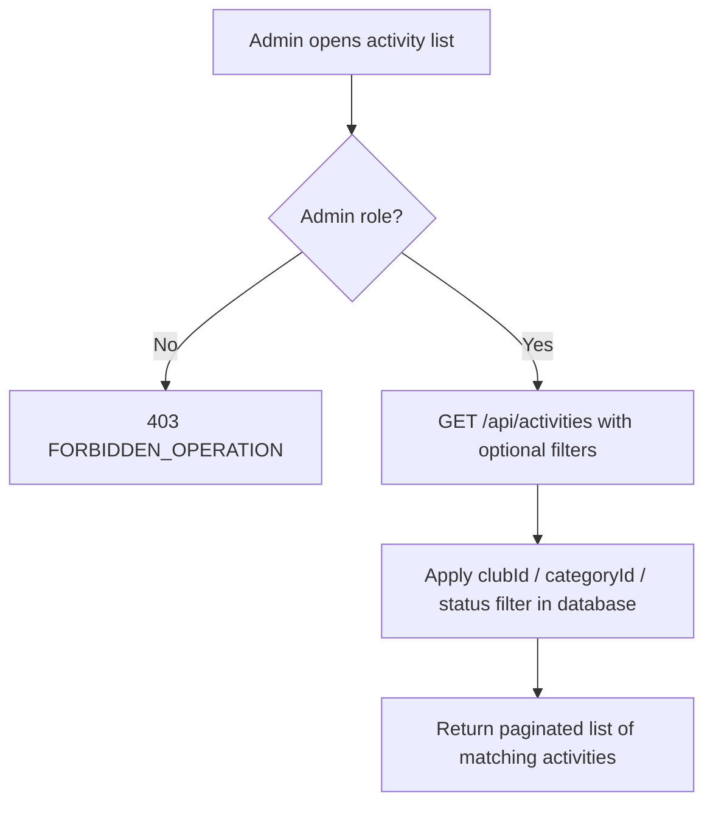

# User Story US004 - Browse and Filter Activities

## 1. Description

Allows an admin to list activities and filter them by `clubId`, `categoryId` and `status`. When no status filter is given, all statuses — including `REJECTED` — are returned. Filtering and pagination are performed in the database rather than in memory.

## 2. User Story Statement

As an admin, I want to browse and filter activities so that I can review and manage them.

## 3. User Flow Diagram

## 4. UX / UI References

- Backend API only in this epic; no dedicated screen yet.
- Design system: Onshore design system (activity screens pending).

## 5. Dependencies

- Blocking: EP003 Clubs — `clubId` filter values.
- Blocking: EP001 Categories — `categoryId` filter values.
- Blocking: api-gateway route for `/api/activities/**`.

## 6. Personas & Primary Users

- Admin — reviews and manages the activity catalog.

## 7. Acceptance Criteria

| ID  | Given                                  | When                                         | Then                                                   |
| --- | -------------------------------------- | -------------------------------------------- | ------------------------------------------------------ |
| AC1 | Activities exist in several statuses   | I list activities with a `status` filter     | Only activities with that status are returned          |
| AC2 | Activities exist in several clubs      | I list activities with a `clubId` filter     | Only activities of that club are returned              |
| AC3 | Activities exist in several categories | I list activities with a `categoryId` filter | Only activities of that category are returned          |
| AC4 | Activities exist in several statuses   | I list activities without filters            | All activities are returned, including `REJECTED` ones |
| AC5 | I am not an admin                      | I list activities                            | The request is rejected with 403 `FORBIDDEN_OPERATION` |

## 8. Notes / Additional Information

- Filtering and pagination are performed in the database (FR-14, Could priority).
- There is no public activity listing (BR-04); listing is admin-only.
