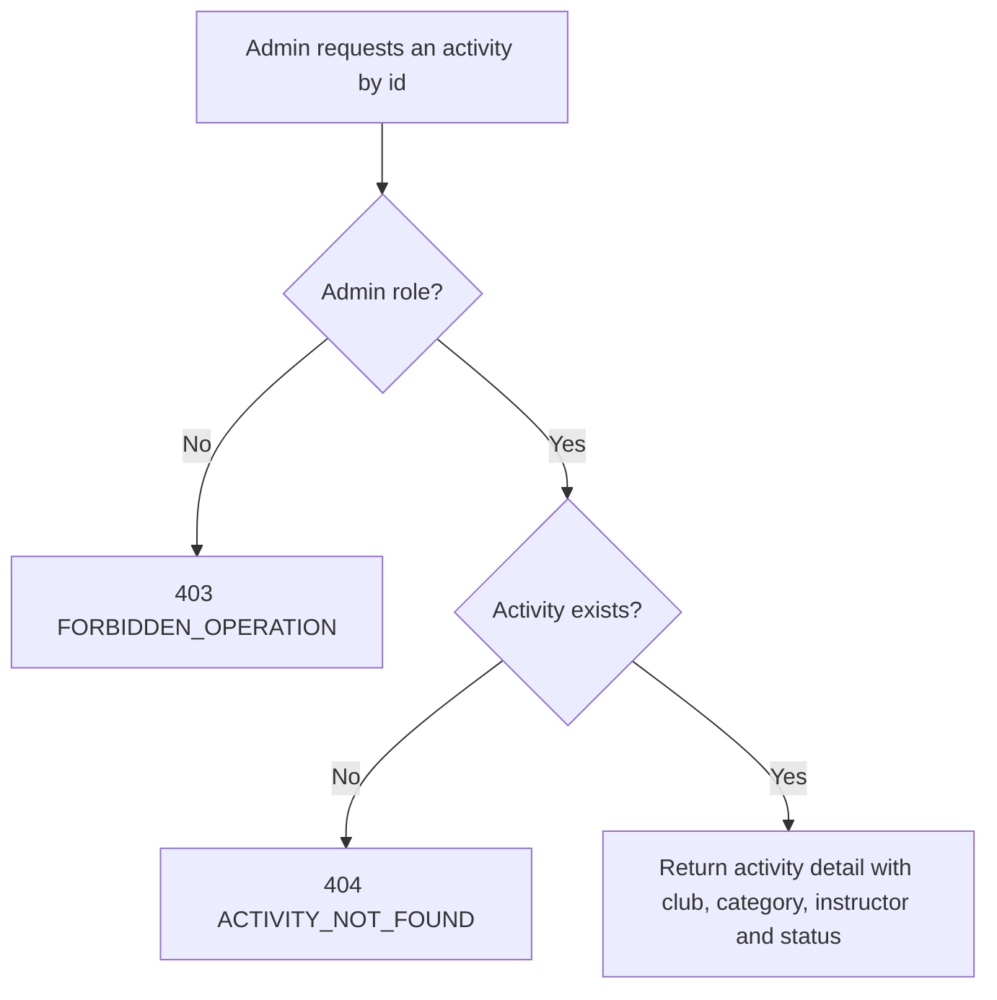

# User Story US005 - View an Activity Detail

## 1. Description

Allows an admin to fetch a single activity by id, including its club, category, instructor contact and status. Only admins can call this endpoint.

## 2. User Story Statement

As an admin, I want to see an activity's details, instructor and club so that I can review it.

## 3. User Flow Diagram

## 4. UX / UI References

- Backend API only in this epic; no dedicated screen yet.
- Design system: Onshore design system (activity screens pending).

## 5. Dependencies

- Blocking: EP003 Clubs — detail includes the referenced club.
- Blocking: EP001 Categories — detail includes the referenced category.
- Blocking: api-gateway route for `/api/activities/**`.

## 6. Personas & Primary Users

- Admin — reviews an activity in detail.

## 7. Acceptance Criteria

| ID  | Given                                | When                        | Then                                                     |
| --- | ------------------------------------ | --------------------------- | -------------------------------------------------------- |
| AC1 | I am an admin and an activity exists | I request it by id          | I get its details, instructor, club, category and status |
| AC2 | I am an admin and the id is unknown  | I request an activity by id | The request is rejected with 404 `ACTIVITY_NOT_FOUND`    |
| AC3 | I am not an admin                    | I request an activity by id | The request is rejected with 403 `FORBIDDEN_OPERATION`   |

## 8. Notes / Additional Information

- The detail exposes instructor contact fields; these must not be written to logs (NFR-03).
- The partner is resolved through the club and included where applicable (BR-03).
