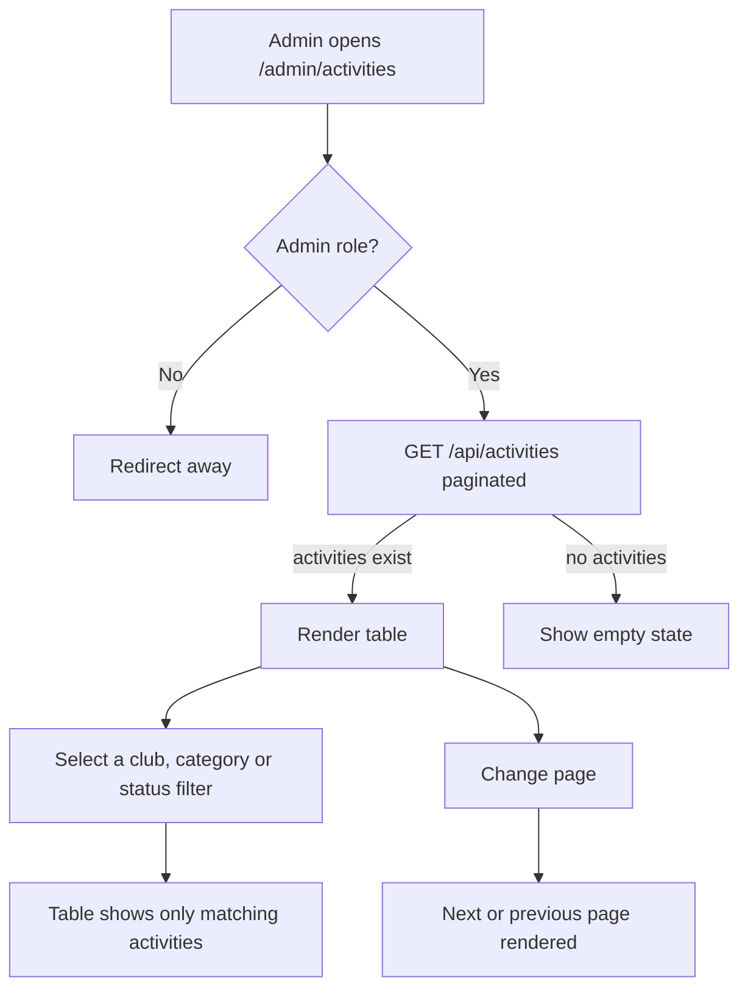

# User Story US001 - Browse and Filter Activities

## 1. Description

Admin-only page at `/admin/activities` that lists every activity and lets an operator filter by club, category and status, with pagination. It reuses the existing `AdminShell` + table pattern (like `AdminClubs` / `AdminCategories`) with an empty state and an error banner. Non-admins cannot reach the page.

## 2. User Story Statement

As an admin, I want to browse and filter activities so that I can review and manage the platform's activity catalog.

## 3. User Flow Diagram

## 4. UX / UI References

- Design system: Onshore design system (activity list screen pending).
- Components: `PageHeader`, `EmptyState`, `ErrorBanner`, `Badge`, `Select`, table, pagination controls.
- Navigation: `AdminShell` link "Activités" with the `Dumbbell` icon.
- TODO: Figma link for the activity list once available.

## 5. Dependencies

- Blocking: EP005 Activities backend — `GET /api/activities` (admin-only, paginated).
- Blocking: `ROLE_SYSTEM_ADMIN` route protection via `ProtectedRoute` and `AdminShell`.
- Blocking: `adminSlice.clubs` (club list) and `adminSlice.categories` (category list) for the filter options.
- Blocking: `src/services/activityService.js` `listActivities` + `adminSlice.fetchActivities`.

## 6. Personas & Primary Users

- Admin — reviews and manages the activity catalog.

## 7. Acceptance Criteria

| ID  | Given                                             | When                                       | Then                                                    |
| --- | ------------------------------------------------- | ------------------------------------------ | ------------------------------------------------------- |
| AC1 | I am an admin on `/admin/activities`              | The page loads                             | The list of activities is displayed (or an empty state) |
| AC2 | I am not an admin                                 | I open `/admin/activities`                 | I am redirected and cannot access the page              |
| AC3 | Activities exist across clubs/categories/statuses | I filter by a club, a category or a status | Only matching activities are shown                      |
| AC4 | More activities exist than fit on one page        | I change the page                          | The next or previous page of activities is shown        |
| AC5 | No activities match the selected filters          | I apply the filters                        | An empty state is shown                                 |
| AC6 | The request fails                                 | The page loads                             | An error message is shown via the error banner          |

## 8. Notes / Additional Information

- Activity APIs are admin-only; there is no public activity listing (EP005 BR-04).
- The list endpoint is paginated (Spring `Page`), unlike the clubs/categories lists.
- The list + modal pattern is used in v1; a dedicated detail page is deferred.
- Error responses follow the RFC 9457 envelope surfaced by `ApiError`.
