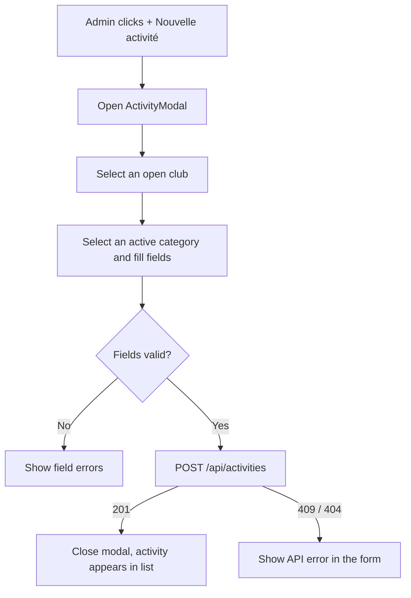

# User Story US002 - Create an Activity

## 1. Description

Admin creates an activity from a modal on `/admin/activities`. The operator first selects an open club, then an active category, fills the mandatory `name` and optional fields (`description`, instructor contact, `subscriptionDate`). Client-side validation runs before the request; on success the activity is created with status `ACTIVE` and appears in the list.

## 2. User Story Statement

As an admin, I want to create an activity for an open club and an active category so that it is offered on the platform.

## 3. User Flow Diagram

## 4. UX / UI References

- Design system: Onshore design system (activity create form pending).
- Components: `Modal`, `Field`, `Input`, `Select`, `Textarea`, `Button`, `Toaster`.
- TODO: Figma link for the "Create activity" form once available.

## 5. Dependencies

- Blocking: EP005 Activities backend — `POST /api/activities`.
- Blocking: `adminSlice.clubs` (open clubs) and `adminSlice.categories` (active categories) for the selectors.
- Blocking: US001 - Browse and Filter Activities (the page hosting the modal).
- Blocking: `src/services/activityService.js` `createActivity` + `adminSlice.saveActivity`.

## 6. Personas & Primary Users

- Admin — registers activities for any club.

## 7. Acceptance Criteria

| ID   | Given                                                      | When                                                        | Then                                                                             |
| ---- | ---------------------------------------------------------- | ----------------------------------------------------------- | -------------------------------------------------------------------------------- |
| AC1  | I am an admin                                              | I click "+ Nouvelle activité"                               | The modal opens with the club selector first                                     |
| AC2  | I select an open club, an active category and a valid name | I submit the form                                           | The activity is created with status `ACTIVE` and appears in the list             |
| AC3  | I do not select a club                                     | I submit the form                                           | A validation error is shown and no request is sent                               |
| AC4  | A mandatory field (`categoryId` or `name`) is missing      | I submit the form                                           | Field errors are shown and no request is sent                                    |
| AC5  | I enter an invalid `instructorEmail`                       | I submit the form                                           | A validation error is shown and no request is sent                               |
| AC6  | The backend returns 409 `ACTIVITY_ALREADY_EXISTS`          | I create an activity with a duplicate name in the same club | The error "Une activité porte déjà ce nom dans ce club" is displayed in the form |
| AC7  | The backend returns 409 `CLUB_CLOSED`                      | I create an activity for a closed club                      | The error "Le club est fermé" is displayed in the form                           |
| AC8  | The backend returns 409 `PARTNER_NOT_ACTIVE`               | I create an activity for a club whose partner is not active | The error "Le partenaire n'est pas actif" is displayed in the form               |
| AC9  | The backend returns 404 `CATEGORY_NOT_FOUND`               | I create an activity with an unknown or inactive category   | The error "Catégorie inconnue ou inactive" is displayed in the form              |
| AC10 | A request is in progress                                   | I submit the form                                           | The submit button is disabled to prevent duplicate submissions                   |

## 8. Notes / Additional Information

- An activity is created with status `ACTIVE`; the status is changed later through US004.
- `subscriptionDate` is optional on create and defaults to the creation date (EP005 FR-03).
- Instructor contact fields are optional; `instructorEmail`, when provided, must be well formed.
- The club selector is limited to open clubs; the category selector to active categories.
- `CLUB_NOT_FOUND` (404) can also surface if the selected club was removed in the meantime; it is shown through the same `ApiError` form path.
