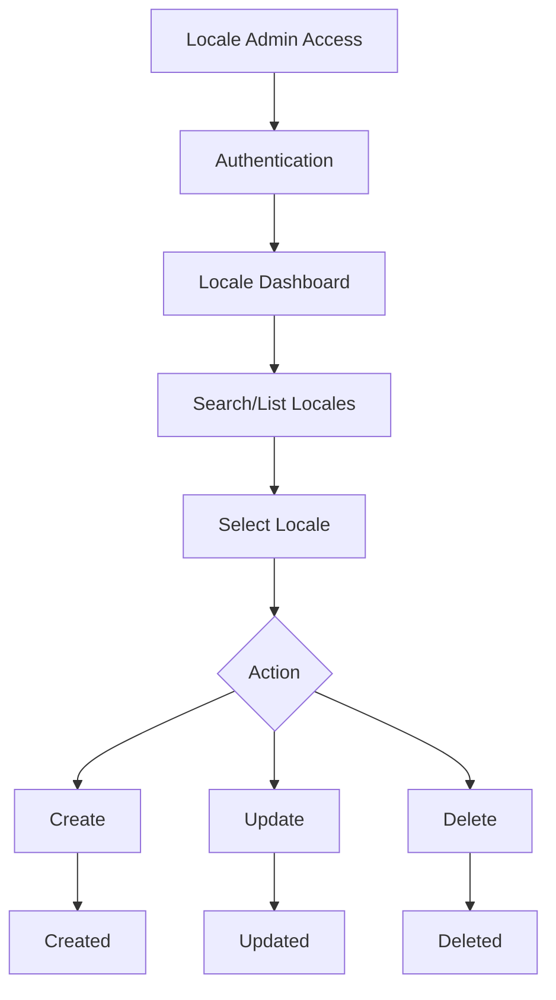

# Epic 002: End-to-End Locale Management

## **Epic Title**

Example: End-to-End Locale Management

Guidance: Concise, action-oriented name summarizing the capability or outcome. Avoid internal code names.

## **Epic Description**

Example: This epic standardizes on the canonical concept of a "Locale" (language + optional region) aligning with the platform referential (`LOCALES` table) and removing ambiguity with pure language codes.

Guidance: 2–4 sentences answering WHY this matters, WHAT core problem it solves, and the key concept alignment (data model / domain boundaries).

## **Stakeholders**

Example:

| Persona | Repo Persona File | Primary Interests | Responsibilities |
|---------|-------------------|------------------|------------------|
| Administrator | `administrator.md` | Referential integrity & auditability | Approves production locales; monitors audit logs |
| Market Lead | `market.md` | Regional coverage | Requests new locales; validates readiness |
| Publishing Specialist | `publishing.md` | Content scheduling alignment | Ensures content bundles for active locales |

Guidance: List only personas that actively influence decisions or consume outputs. Each row should express a single, testable responsibility (avoid vague verbs like "oversees").

## **Business Value / Rationale**

Example:

- **Global Market & Regional Support:** Enable platform to support multiple markets with precise locale (language + region) settings.
- **Administrative Efficiency:** Provide intuitive interfaces for managing locale configurations across system components.
- **Scalability:** Foundation for adding new locales / markets as business expands.
- **Compliance:** Support regional regulatory / linguistic variants (e.g., fr-CA vs fr-FR).

Guidance: Use bullet points; bold the theme, follow with a succinct impact statement. Focus on external value (revenue enablement, risk reduction, cost efficiency) over internal implementation desires.

## **Scope / Boundaries**

Example Included:

- CRUD lifecycle for locale referential (`LOCALES`).
- UI screens for listing, creating, editing, deleting locales.
- Validation (uniqueness, format, fallback linkage rules).
- Audit trail events on create/update/delete.

Example Explicitly Excluded (add this section if helpful):

- Front-end runtime locale switching UX (handled by separate personalization epic).
- Translation content management workflows.
- Batch import/export pipelines beyond initial seed.

Guidance: Separate Included vs Excluded to minimize scope creep. Every excluded item should map to another epic or a documented backlog candidate. Limit technical implementation details, focus only on functional description

## **Priority**

Example: High – foundational for international market support and prerequisite for downstream content localization epics.

Guidance: Provide a short rationale (dependency chain, regulatory date, revenue opportunity). Avoid raw MoSCoW labels without justification.

## **Data Model Alignment (Extract from `complete-data-model.md`)**

Example Narrative: Canonical alignment with authoritative entities. Field names mirror conceptual model; physical layer may adjust constraints / indexes.

```text
LOCALES {
    uuid id PK
    text locale_id
    text iso_id
    text label
    text mapping_pearl
    text mapping_wezen
    text mapping_storelocator
    text fallback_locales
    text linked_locales
    timestamp created_date
    timestamp updated_date
}

SITES {
    uuid id PK
    uuid market_fk_id FK -> markets(id)
    text site_id
    text hreflang
    uuid default_locale_fk_id FK -> locales(id)
    timestamp created_date
    timestamp updated_date
}

SITE_LOCALES {
    uuid site_fk_id FK -> sites(id)
    uuid locale_fk_id FK -> locales(id)
    timestamp created_date
    timestamp updated_date
    # composite PK (site_uuid, locale_uuid)
}

GENERIC_AUDITTRAIL {
    uuid audittrail_uuid PK
    text entity_type
    text entity_uuid
    text event_type
    text role
    text division
    text market
    timestamp event_date
    text additional_info
    text value_before
    text value_after
}
```

Guidance: Provide only the minimum set of entities needed to reason about scope. Reference the authoritative model file for full details instead of duplicating all tables.

## **Epic Flow Diagram**

Example:



Guidance: Show user decision points with diamonds (or curly brace notation). Omit technical subsystems; focus on user-visible flow.

## **Related User Stories**

Example:

| ID | Title | Notes |
|----|-------|-------|
| US001 | List Locales | Client-side filtering; columns mirror LOCALES |
| US002 | Create & Update Locale | Uniqueness, pattern validation, audit events |
| US003 | Locale REST & Alias API | CRUD + optional legacy alias (no pagination v1) |
| US004 | Seed Locales via Liquibase | Deterministic initial dataset (CSV) |
| US006 | Delete Locale (Guarded) | Hard delete with dependency checks on sites |

Guidance:List all the user stories Each story title should be testable and outcome-focused. Use Notes for constraints / non-functional nuances.
