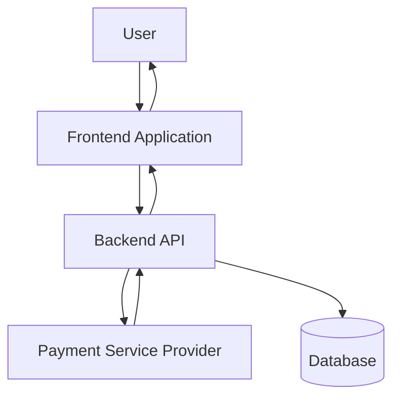
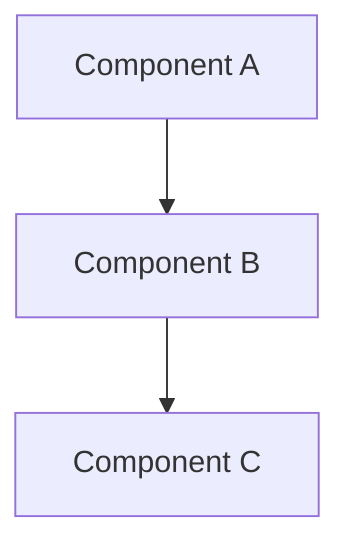
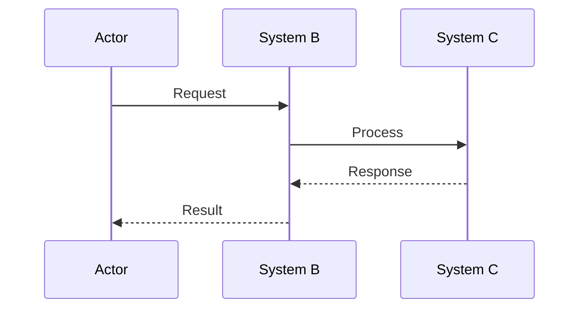
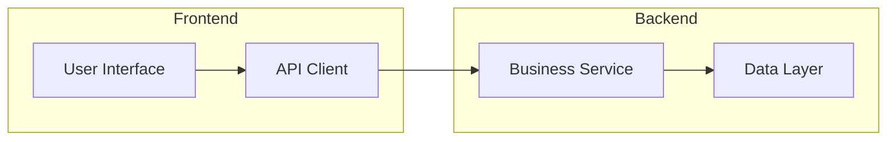

# Overall Architecture Template

## Purpose

Generate the overall architecture section with Mermaid diagrams for a tech design document.

## Template Variables

- `{{HIGH_LEVEL_DIAGRAM}}` - Mermaid diagram code showing system architecture
- `{{FLOW_DESCRIPTION}}` - Explanation of how data and control flow between components
- `{{INTEGRATION_POINTS}}` - List and description of external systems involved

## Output Format

```markdown
## Overall Architecture

### High-Level Architecture Diagram

```mermaid
{{HIGH_LEVEL_DIAGRAM}}
```

### Flow Description

{{FLOW_DESCRIPTION}}

### Integration Points

{{INTEGRATION_POINTS}}

```

## Example Usage

```markdown
## Overall Architecture

### High-Level Architecture Diagram



### Flow Description

The payment flow begins when a user initiates a payment through the frontend application. The frontend sends a payment request to the backend API, which validates the request and forwards it to the Payment Service Provider (PSP). The PSP processes the payment and returns a response to the backend, which then updates the database and sends the final status back to the frontend for user display.

### Integration Points

- **Payment Service Provider (PSP X)**: External payment processing service with REST API integration
- **Database**: Internal PostgreSQL database for storing payment records and transaction history
- **Frontend Application**: React-based e-commerce interface for user interactions

```

## Mermaid Diagram Types

### Architecture Diagram


### Sequence Diagram



### Component Diagram



## Guidelines

- Use clear, descriptive names for components
- Show data flow direction with arrows
- Group related components in subgraphs
- Include external systems and dependencies
- Keep diagrams readable and not overly complex
- Provide detailed flow descriptions that complement the diagrams
- List all integration points with brief descriptions of their purpose
