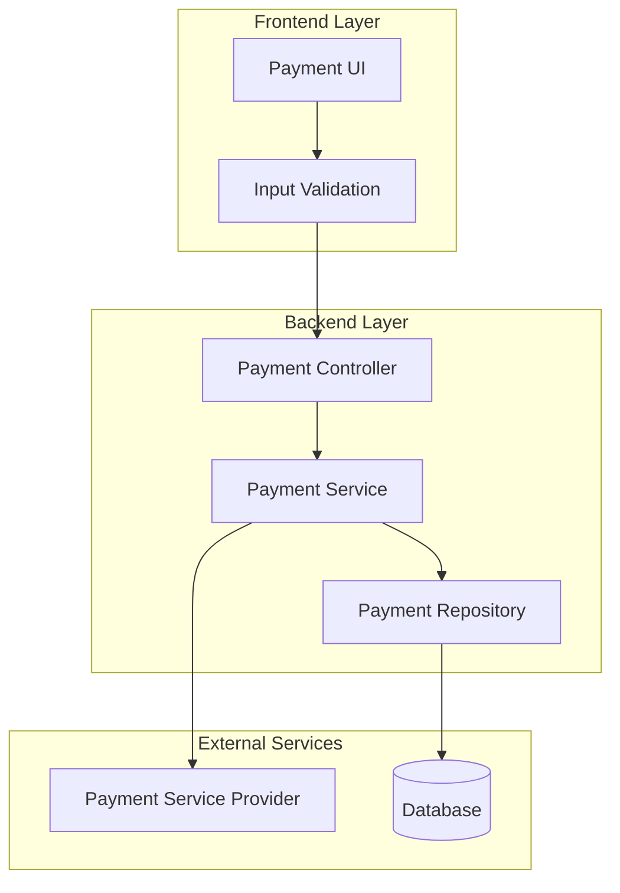
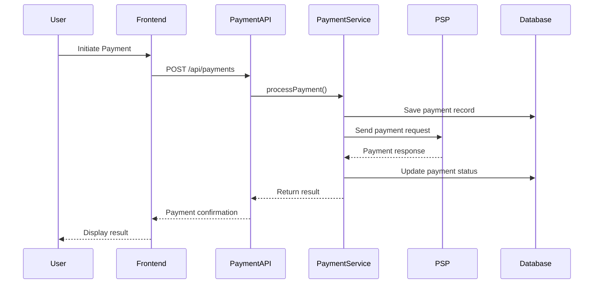
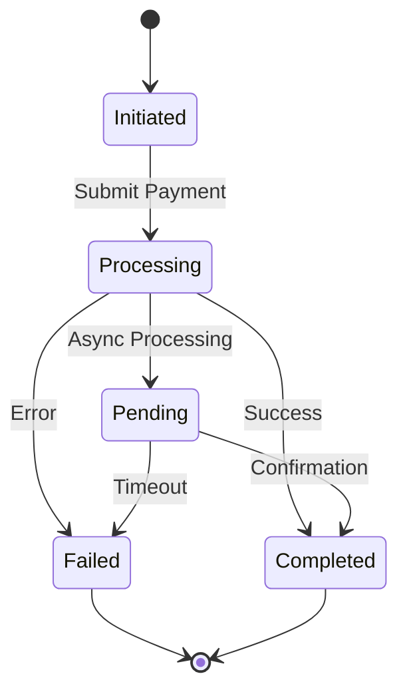
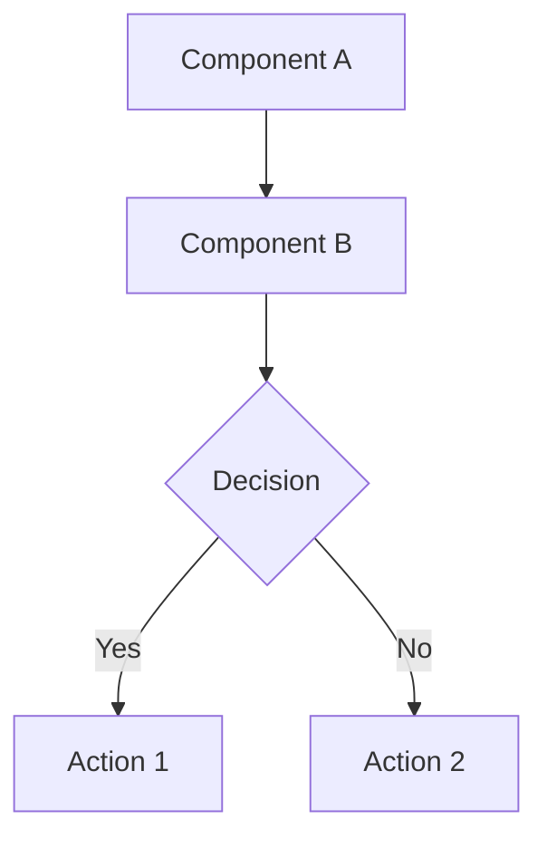
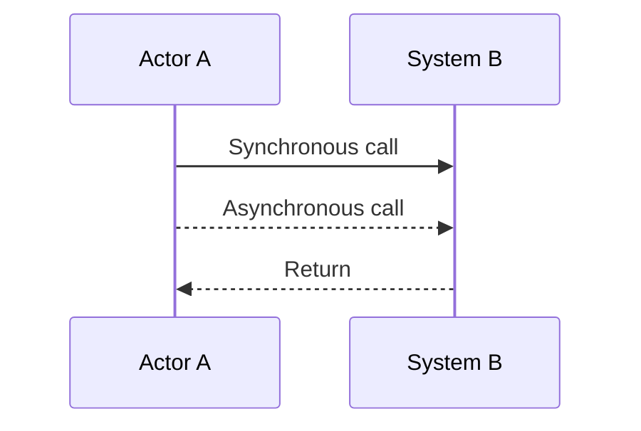
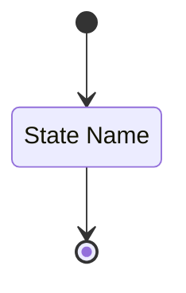
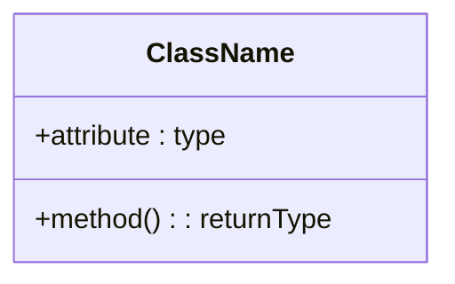

# Diagrams Template

## Purpose

Generate detailed technical diagrams using Mermaid syntax for component interactions, sequences, and state flows.

## Template Variables

- `{{COMPONENT_DIAGRAM}}` - Mermaid diagram showing component interactions
- `{{SEQUENCE_DIAGRAM}}` - Mermaid diagram illustrating execution order
- `{{STATE_DIAGRAM}}` - Mermaid diagram for workflows with multiple states (optional)

## Output Format

```markdown
## Diagrams

### Component Interaction Diagram

```mermaid
{{COMPONENT_DIAGRAM}}
```

### Sequence Diagram

```mermaid
{{SEQUENCE_DIAGRAM}}
```

### State Flow Diagram

```mermaid
{{STATE_DIAGRAM}}
```

```

## Example Usage

```markdown
## Diagrams

### Component Interaction Diagram



### Sequence Diagram



### State Flow Diagram



```

## Mermaid Diagram Reference

### Component Diagrams


### Sequence Diagrams



### State Diagrams



### Class Diagrams



## Guidelines

- Use component diagrams to show how different parts of the system interact
- Use sequence diagrams to illustrate the order of operations and message flow
- Use state diagrams for complex workflows with multiple states and transitions
- Keep diagrams focused and not overly complex
- Use descriptive names for all components and interactions
- Include decision points and error flows where relevant
- Group related components using subgraphs for better organization
- Ensure diagrams complement and enhance the written documentation
