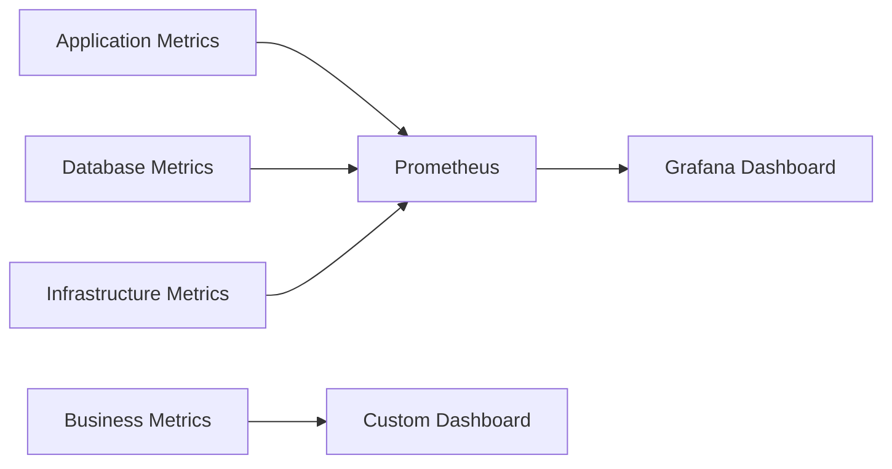
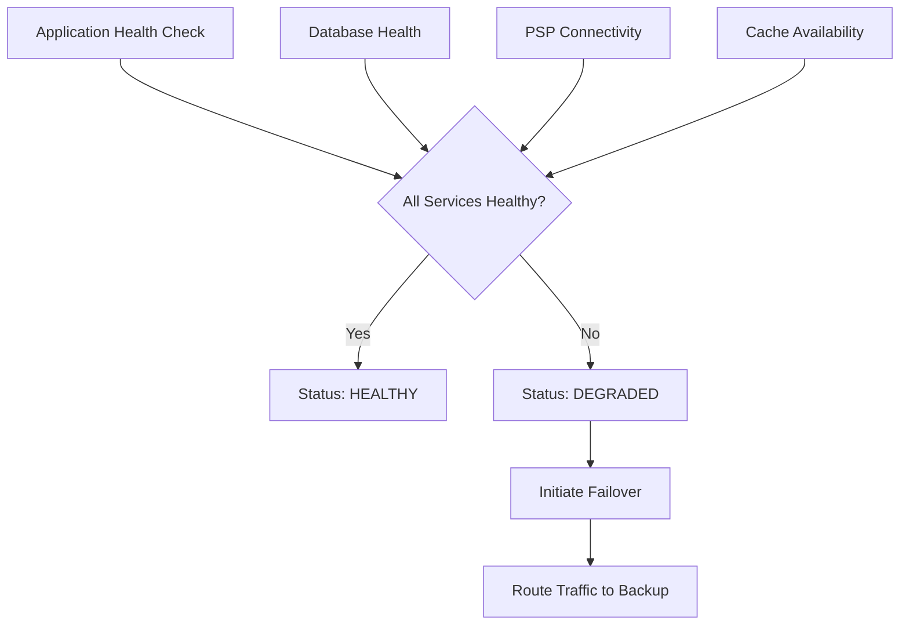

# Security, Performance, and Resiliency Template

## Purpose

Generate documentation for security measures, performance optimizations, and resiliency mechanisms.

## Template Variables

- `{{SECURITY_MEASURES}}` - Security implementations, compliance, and risk mitigation
- `{{PERFORMANCE_OPTIMIZATIONS}}` - Performance enhancements and optimization strategies
- `{{RESILIENCY_MECHANISMS}}` - Fallback, recovery, and fault tolerance mechanisms

## Output Format

```markdown
## Security, Performance, and Resiliency

### Security Measures

{{SECURITY_MEASURES}}

### Performance Optimizations

{{PERFORMANCE_OPTIMIZATIONS}}

### Resiliency Mechanisms

{{RESILIENCY_MECHANISMS}}
```

## Example Usage

```markdown
## Security, Performance, and Resiliency

### Security Measures

**Authentication & Authorization**:
- OAuth 2.0 with JWT tokens for API authentication
- Role-based access control (RBAC) for different user types
- API key rotation policy: 90-day mandatory rotation
- Multi-factor authentication (MFA) required for administrative operations

**Data Protection**:
- All payment data encrypted at rest using AES-256 encryption
- TLS 1.3 mandatory for all communications in transit
- PII data masked in application logs and monitoring systems
- Database field-level encryption for sensitive payment information

**API Security**:
- Rate limiting: 1000 requests per minute per API key
- Request/response payload size limits: 1MB maximum
- Input validation and sanitization for all API endpoints
- CORS policy configured to allow only authorized domains

**Compliance & Governance**:
- PCI DSS Level 1 compliance through PSP infrastructure
- GDPR compliance with data retention policies (7 years for financial records)
- SOX compliance for financial reporting and audit trails
- Regular security audits and penetration testing (quarterly)

**Infrastructure Security**:
- Network segmentation with DMZ for public-facing services
- Web Application Firewall (WAF) with OWASP Top 10 protection
- Container security scanning in CI/CD pipeline
- Secrets management using HashiCorp Vault

**Monitoring & Incident Response**:
- Security Information and Event Management (SIEM) integration
- Automated threat detection and alerting
- Incident response playbook with 4-hour response SLA
- Security metrics dashboard for real-time monitoring

### Performance Optimizations

**Database Optimization**:
- Connection pooling with HikariCP (max 20 connections per instance)
- Read replicas for reporting and analytics queries
- Database query optimization with proper indexing strategy
- Partitioning of payment tables by date for faster queries

**Caching Strategy**:
- Redis cache for frequently accessed payment status data (TTL: 5 minutes)
- Application-level caching for configuration and lookup data
- CDN caching for static resources and API documentation
- Cache warming strategies during deployment

**API Performance**:
- Response compression (GZIP) for payloads over 1KB
- API response pagination for large datasets (max 100 items per page)
- Async processing for non-critical operations (notifications, logging)
- Connection keep-alive for PSP API calls to reduce latency

**Application Optimization**:
- JVM tuning with G1GC garbage collector
- Thread pool optimization for concurrent request handling
- Lazy loading for optional payment data fields
- Batch processing for bulk operations (refunds, settlements)

**Resource Management**:
- Auto-scaling policies based on CPU and memory utilization
- Resource limits: 2 CPU cores, 4GB RAM per container instance
- Health check endpoints for load balancer configuration
- Graceful shutdown handling for rolling deployments

**Monitoring & Metrics**:


**Performance Targets**:

| Metric | Target | Monitoring |
|--------|--------|------------|
| API Response Time | < 300ms (95th percentile) | Real-time alerts |
| Database Query Time | < 100ms (average) | Slow query logs |
| System Throughput | > 500 TPS | Load testing |
| Memory Usage | < 80% of allocated | Container monitoring |

### Resiliency Mechanisms

**Fault Tolerance Patterns**:

**Circuit Breaker Implementation**:

```java
@Component
public class PSPCircuitBreaker {
    
    @CircuitBreaker(name = "psp-service", fallbackMethod = "fallbackPayment")
    @TimeLimiter(name = "psp-service")
    @Retry(name = "psp-service")
    public CompletableFuture<PaymentResponse> processPayment(PaymentRequest request) {
        return pspClient.processPaymentAsync(request);
    }
    
    public CompletableFuture<PaymentResponse> fallbackPayment(PaymentRequest request, Exception ex) {
        // Fallback to queued processing
        paymentQueue.enqueue(request);
        return CompletableFuture.completedFuture(
            PaymentResponse.builder()
                .status("QUEUED")
                .message("Payment queued for processing")
                .build()
        );
    }
}
```

**Retry Mechanisms**:

- Exponential backoff strategy: Initial delay 1s, max delay 30s, max 5 attempts
- Jitter implementation to prevent thundering herd problems
- Idempotency keys for safe payment operation retries
- Dead letter queue for permanently failed operations

**Graceful Degradation**:

- Fallback to cached payment status when PSP is unavailable
- Queued payment processing during system maintenance
- Read-only mode during database failover scenarios
- Simplified UI experience during partial system outages

**Data Redundancy & Backup**:

- Multi-region database replication with automatic failover
- Point-in-time recovery capability (PITR) with 7-day retention
- Automated daily backups with 30-day retention policy
- Cross-region backup replication for disaster recovery

**Disaster Recovery**:

- Recovery Time Objective (RTO): 2 hours
- Recovery Point Objective (RPO): 15 minutes
- Automated failover to secondary data center
- Regular disaster recovery testing (monthly)

**Health Monitoring**:



**Operational Procedures**:

- Automated rollback triggers based on error rate thresholds (>5% error rate)
- Blue-green deployment strategy for zero-downtime updates
- Canary releases for gradual feature rollout (10% traffic initially)
- Emergency procedures documented with contact information and escalation paths

**SLA Commitments**:

| Service Level | Target | Measurement |
|---------------|--------|-------------|
| System Availability | 99.9% uptime | Monthly calculation |
| Payment Processing | 99.95% success rate | Real-time monitoring |
| Data Durability | 99.999999999% | Annual assessment |
| Support Response | 2-hour response time | Ticket system tracking |

```

## Guidelines

- Address security requirements comprehensively including compliance needs
- Include specific performance metrics and targets with measurement methods
- Document all failure scenarios and corresponding recovery procedures
- Provide concrete implementation examples for critical patterns
- Include monitoring and alerting strategies for each aspect
- Consider operational procedures and runbooks for incident response
- Address scalability requirements and auto-scaling policies
- Include disaster recovery planning with specific RTO/RPO targets
- Document trade-offs between security, performance, and usability
- Provide implementation timelines and priorities for different measures
