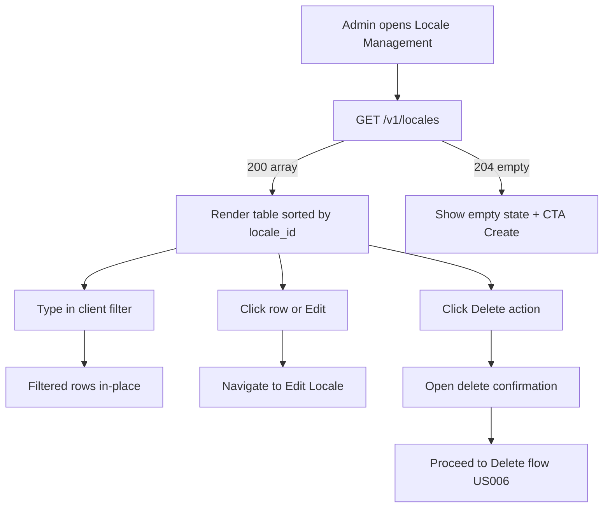

# User Story USXXX - Your Concise Title

Guidance: Replace `USXXX` with the numeric identifier (e.g., US001). Title pattern: `US### - <Action / Domain>` (user‑oriented, unique, searchable). Keep consistent with folder/file naming.

Example: User Story US001 - List Locales (Client Filter Only)

## 1. Description

Guidance: 2–5 sentences answering WHAT the feature does, its immediate scope boundaries (what is explicitly deferred), and notable behavioral nuances (e.g., "client-side filtering only"). Avoid low-level implementation detail.

Example: Displays the full, unpaginated list of configured locales to administrators, with lightweight client-side filtering on `locale_id` and `label`. Provides clear loading and empty states, navigations to edit/delete flows, and normalizes display casing (e.g., `fr-FR`). No server-side pagination or filtering in v1; the API returns either 200 (array) or 204 (empty).

## 2. User Story Statement

Guidance: Classic WHO / WHAT / WHY sentence: As a `persona`, I want `capability` so that `benefit`. The WHY must express user or business value (not implementation convenience). Keep a single main value proposition.

Example: As an Administrator, I want to view the full list of configured locales (without pagination) so that I can quickly verify locale availability and navigate to create, update, or delete flows.

## 3. User Flow Diagram

Guidance: Mermaid diagram capturing the main path plus critical alternative paths (empty, error, branching actions). Keep labels user-observable. Avoid exhaustive technical states.

Example:

## 4. UX / UI References

Guidance: Bullet list referencing design source(s) (Figma, wireframes), component library versions, accessibility expectations, and visual state variants (loading, empty, error). If designs are pending, list assumptions and a TODO.

Example:

- Figma: (link to Locales List board)
- Components: DataTable v3, Inline Chips, Skeleton Loader
- Accessibility: Table headers `role=columnheader`; row actions keyboard-focusable; empty state text announced via `aria-live="polite"`

## 5. Dependencies

Guidance: List upstream user stories, epics, services, feature flags, data seeds, auth scopes. Mark each as Blocking or Non-blocking. Use canonical IDs.

Example:

- Blocking: US003 - Locale REST API (GET /v1/locales)
- Blocking: EP001 - Authentication/authorization foundation (admin role)
- Non-blocking (Optional): US004 - Seed initial locales for demo/testing

## 6. Personas & Primary Users

Guidance: Primary persona first; include short intent if not self-evident. Only direct users/beneficiaries.

Example:

- Administrator – governance & audit
- Support Engineer – incident triage
- Market Lead – visibility pre‑activation

## 7.Acceptance Criteria

Guidance: Single Given / When / Then table. Each row is atomic, testable, user-focused, implementation-agnostic. Cover: data presence/absence, interaction flows, formatting, performance (define explicit thresholds + metric), accessibility (WCAG level), error handling, and state transitions. Reference other stories for flows out-of-scope.

Example (excerpt – locale list):

| ID  | Given                                           | When                                              | Then                                                                                           |
| --- | ----------------------------------------------- | ------------------------------------------------- | ---------------------------------------------------------------------------------------------- |
| AC1 | Admin is authenticated AND locales exist        | They open Locale Management and UI calls GET API  | Full list (sorted by locale_id) is displayed; no pagination controls                           |
| AC5 | Data fetching in progress                       | Initial load pending after GET issued             | Loading indicator visible until 200 array or 204 empty response received                       |
| AC11| A locale stored as 'fr-fr'                      | The list is rendered                              | The locale_id is displayed normalized as 'fr-FR'                                               |
| AC14| 500 locales loaded and admin types filter text  | User stops typing (debounce elapsed)              | Filtered results update within 100ms; no network request performed                             |
| AC15| Locale list table displayed                     | Accessed via keyboard + screen reader             | Proper accessible semantics (headers association, focusable actions, ARIA labels) WCAG AA       |

Full example reference: see US001 description for the complete criteria list. Tailor count to story scope.

## 8. Notes / Additional Information

Guidance: Rationale, constraints, deferred scope, telemetry/events, non-functional assumptions, security/privacy, standards references (RFC / internal), ADR links. No repetition of ACs.

Example:

- v1 intentionally omits server-side pagination & filtering; revisit after usage metrics
- Delete guarded in US006; this story only exposes entry points & blocked state messaging
- Error envelopes: EP002 standard (RFC 9457 style)
- Telemetry: `load_duration_ms` (first paint table/empty state), `filter_latency_ms` (client filter debounce + apply)

---

TIP: After drafting, check: (1) Each AC maps to a distinct user intent; (2) No redundant ACs; (3) No implementation detail in ACs; (4) Flow diagram matches description and ACs; (5) Story title matches content.
